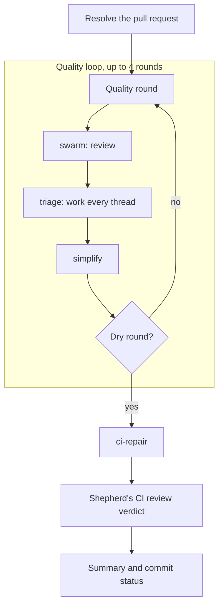
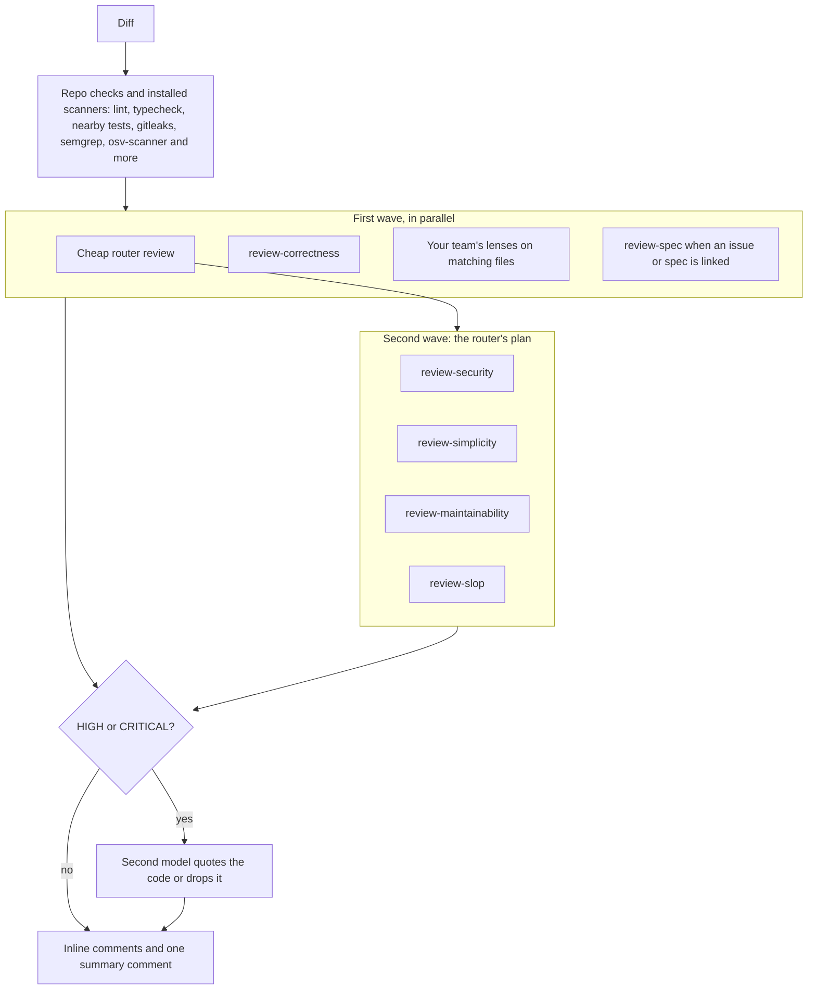
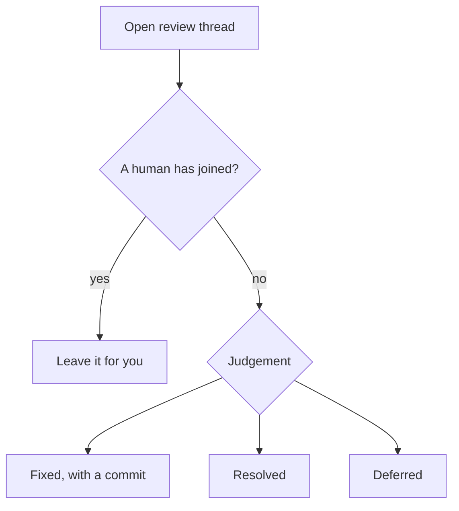

`/shepherd <pr>` is the loop you run from your coding agent. Each iteration reviews the pull request, works every review thread, simplifies, repairs CI, and then reads the verdict from Shepherd's review in CI.

:::note
The review in GitHub Actions is a single reviewer that changes no code. To set it up, see [Set up the review in GitHub Actions](/shepherd/integrations/github-actions/).
:::

## Follow one iteration

An iteration runs up to four quality rounds, then CI repair:

### When a round is dry

The loop stops running rounds once one comes back dry. A round is dry if all of these hold:

- **Triage**: triage fixed, resolved and promoted nothing.
- **Simplify**: simplify changed nothing.
- **Bot reviews**: no bot review is still on its way.

Round 1's fixes always get a second review round.

### Findings from Claude Code Review

On a repository with Claude Code Review, Shepherd reads its check run to know whether the review finished or didn't run. Shepherd handles its findings by severity:

- **🔴 Important and 🟡 Nit**: Shepherd fixes them like any bot finding.
- **🟣 Pre-existing**: Shepherd leaves them to you as follow-ups.

### Later rounds review what moved

After round 1, the review reads only what moved since the last reviewed head. `shepherd interdiff` compares the pull request's own change at the last reviewed head with the change at the new head. It squashes each one onto its own merge base first. A base merge or a rebase then reads as no change, and a force-push still compares cleanly.

Reviewers read the diff from `shepherd number`, which writes out each line's old and new numbers. A finding cites its line directly: on the new side, or on the old side for deleted code.

### Base conflicts

If the base conflicts, ci-repair merges it and resolves the conflict, as long as no decision hides in it:

- **Paths**: nothing under `escalate.paths` or a deferred thread.
- **Risk**: nothing risky.
- **Product**: no choice of what the product does.

The next iteration reviews the result. The `shepherd` status reaches `success` only if no person's latest review requests changes.

## Stacked pull requests and wrong bases

Before it writes the round's diff, the loop runs `shepherd stack <pr>`. The result sends the loop down one of these paths:

- **Stacked on an open pull request** into the same base: swarm reviews only this pull request's change over the parent's head, and posts nothing on the parent's lines. A stack of three pull requests gets three focused reviews, and swarm reviews each change once. The review in CI holds its approval until someone approves the parent, so the loop finishes `pending`, waiting on the parent.
- **Wrong base**, with most commits already on another long-lived branch (`main`, `master`, `develop`, `release`, `release/*`, `staging`): the loop reviews nothing, sets `failure`, and names the retarget command, `gh pr edit <pr> --base <branch>`.

The review in CI runs the same detection.

## The review swarm

Swarm runs the repository's checks, then reviews in two waves, then verifies serious findings before it posts:

The two waves split the work:

- **First wave**: the router, correctness on the whole diff, and each team lens on the files its `applies_to` matches start together. `shepherd fanout` lists them.
- **Second wave**: runs only if the router asks for another lens on risky hunks.

The lenses don't repeat what the tools already found.

## Triage

Triage ends each thread fixed, resolved or deferred:

Triage never replies, and never touches a thread a person is in.

## Related resources

- [Rules for reviews and fixes](/shepherd/concepts/fix-boundaries/): the rules every reviewer and fixer in the loop follows
- [Skills and human decisions](/shepherd/reference/skills/): what each skill in the loop does
- [Command reference](/shepherd/reference/commands/): `shepherd interdiff`, `shepherd number`, `shepherd stack` and `shepherd fanout`
- [Review before opening a pull request](/shepherd/guides/local-review/): the same rounds on your local change
