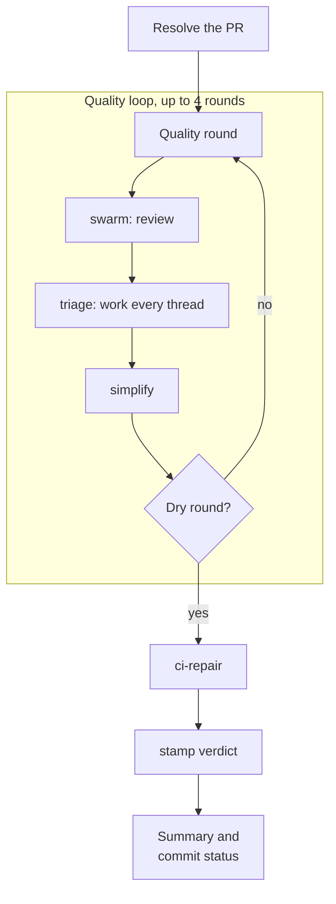
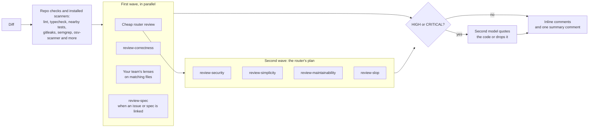
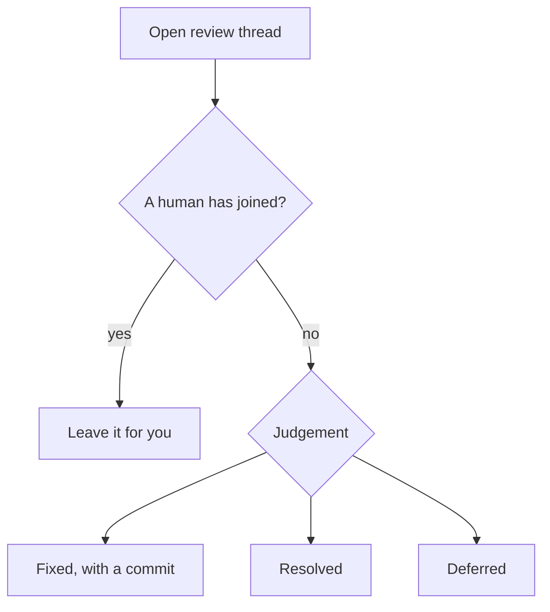

## One iteration

A round is dry when triage fixed, resolved and promoted nothing, simplify changed nothing, and no bot review is still on its way. On a repo with Claude Code Review, shepherd reads its check run to know when the review finished or did not run, fixes 🔴 Important and 🟡 Nit findings like any bot finding, and leaves 🟣 Pre-existing ones to you as follow-ups. Round 1's fixes always get a second review round. In GitHub Actions an iteration runs one round, since swarm cannot comment on commits that are not pushed yet; the next iteration reviews them after the push.

## Stacked PRs and wrong bases

Before it writes the round's diff, the loop runs `shepherd stack <pr>`:

- **Stacked on an open PR** into the same base: swarm reviews only this PR's change over the parent's head and posts nothing on the parent's lines, so a stack of three PRs gets three focused reviews, never one change reviewed three times. stamp holds its approval until the parent is approved, so the loop finishes `pending`, waiting on the parent.
- **Wrong base**, most commits already on another long-lived branch (`main`, `master`, `develop`, `release`, `release/*`, `staging`): the loop reviews nothing, sets `failure` and names the retarget command, `gh pr edit <pr> --base <branch>`.

stamp runs the same detection; see its [stacked PRs guide](https://jagreehal.github.io/stamp/guides/stacked-prs/).

## The review swarm

The first wave starts together: the router, correctness on the whole diff, and each team lens on the files its `applies_to` matches (`shepherd fanout` lists them). A second wave runs only when the router asks for another lens on risky hunks. The lenses don't repeat what the tools already found.

## Triage

Triage ends each thread fixed, resolved or deferred. It never replies and never touches a thread a person is in.
