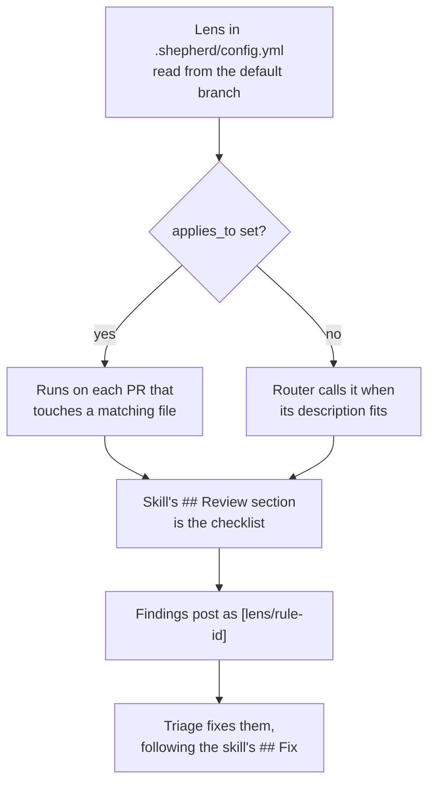
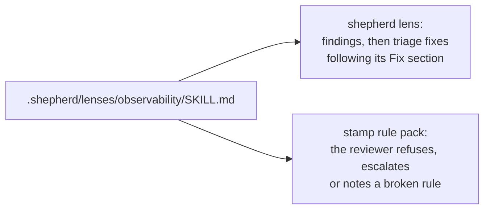

Any skill can review code as a swarm lens: React performance rules, your design system, your API conventions. Point shepherd at the skill and the files it cares about:

```bash
bunx @jagreehal/shepherd lens new react --applies '**/*.tsx'   # scaffolds .shepherd/lenses/react/SKILL.md
bunx @jagreehal/shepherd lens add vercel-react-best-practices --name react-perf \
  --applies '**/*.tsx' --applies '**/*.jsx'          # an existing skill, into .shepherd/config.yml
bunx @jagreehal/shepherd lens add ~/skills/house-style --name house --global   # personal preview
bunx @jagreehal/shepherd lens list
```

```yaml
# .shepherd/config.yml
lenses:
  react:
    skill: vercel-react-best-practices   # an installed skill, or a path to one in the repo
    applies_to: ['**/*.tsx', '**/*.jsx'] # runs whenever a matching file changes
```



Swarm wraps the skill in a review-only brief. The skill's `## Review` section is the checklist, and its findings post like any other lens's (`[react/async-parallel]`). Triage fixes them, following the skill's `## Fix` section when it has one. Nothing in a lens can loosen shepherd's own rules.

shepherd reads the repository's policy file from the default branch, so a PR cannot pick its own reviewers. Run `/swarm --preview` to try a lens from your working tree before you merge it: it reports which files each lens matched and what it found, and posts nothing. `lens list` checks each lens (a description and, for a lens under `.shepherd/lenses/`, a `## Review` with unique rule ids) and exits non-zero on a problem.

Give each rule an id, `- **<id>**: <rule>`. Add a severity tag when a rule names a security or data-loss defect: `- **<id>** [refuse]: <rule>`. Swarm rates a `[refuse]` rule with its full rubric instead of the MEDIUM cap for guidance, and stamp refuses a PR that breaks it. A lens entry can keep a subset of rules with `only` or drop some with `disable`, both rule id globs, and a repository can set either on a pack's lens by name. [Compose reviews for your stack](/shepherd/configuration/stacks/) shows the bundled catalogue and how layers combine, and `/lens-import` converts any other skill into this format.

A `--global` lens is a personal preview. Swarm prints its findings locally and never posts them, so you can try a lens on real PRs before you commit it for the team.

## Starter lenses

A team that wants every change checked for observability can start from the bundled pack instead of a blank file:

```bash
bunx @jagreehal/shepherd lens new observability --from observability --applies 'src/**'
```

That copies `lenses/observability/SKILL.md` into `.shepherd/lenses/observability/` and registers it. Its thirteen rules ask whether an on-call engineer could debug the change in production from its telemetry alone. They flag:

- entry points and outbound calls with no span, and trace context lost across services, queues and background work
- errors that lose their cause, logs that are unstructured or not tied to the trace, and handlers that record nothing about whom a request was for
- secrets or personal data in telemetry, silent data drops, and unbounded names and labels
- new dependencies and jobs no alert could isolate, user-facing changes with no signal, and renamed telemetry that dashboards still read
- telemetry setup that can crash the app or lose its buffer on exit, and sampling or redaction changes that drop what the team relies on

Its `## Fix` section has triage reach for the repository's existing logger and tracer, and send you anything that adds a telemetry dependency or changes telemetry configuration. Edit the rules to fit; `shepherd lens list` shows the templates.

A repository with no tracer or logger yet gets every finding escalated. Add the tracer and logger first, then let the lens hold every later PR to the standard.

## The same pack in stamp

A lens is a `SKILL.md` with id'd rules under `## Review`. [stamp](https://github.com/jagreehal/stamp) reads the same file as a rule pack, so one pack steers the review that fixes code and the gate that approves it:



```yaml
# .stamp/policy.yml
rules:
  observability:
    skill: .shepherd/lenses/observability
    applies_to: ['src/**']
    on_break: escalate
```

To declare every lens once, set `rules_from: { shepherd: {} }` in `.stamp/policy.yml` instead: stamp then reads every shepherd lens as a rule pack, with each lens's `gate` as its `on_break`.

Both read the pack from the default branch, so a PR cannot change the rules it is judged by. stamp also sends any PR that edits a configured pack to a human, since the pack's rules are trusted context for every later review.
