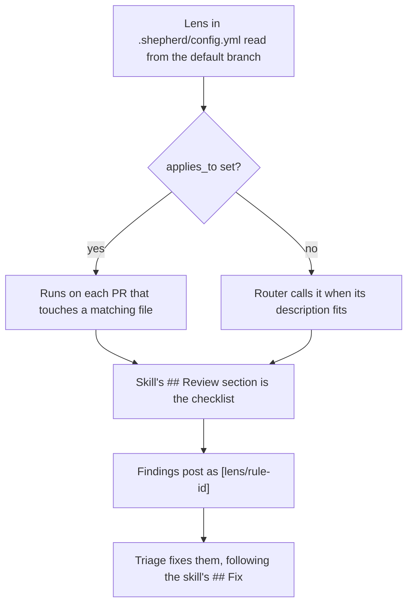
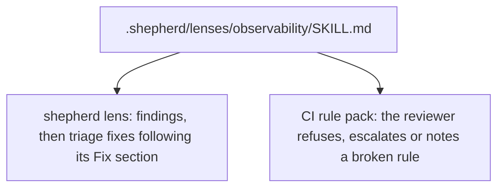

Any skill can review code as a swarm lens: React performance rules, your design system, your API conventions. You point Shepherd at the skill and the files it cares about, and its findings post like any built-in lens's. Shepherd reads the repository's policy file from the default branch, so a pull request can't pick its own reviewers.

:::note
To start from a bundled lens for your framework or language, see [Compose reviews for your stack](/shepherd/configuration/stacks/).
:::

## Add a lens

Scaffold a new lens, register an existing skill, or add a personal one from the command line:

```bash
bunx @jagreehal/shepherd lens new react --applies '**/*.tsx'   # scaffolds .shepherd/lenses/react/SKILL.md
bunx @jagreehal/shepherd lens add vercel-react-best-practices --name react-perf \
  --applies '**/*.tsx' --applies '**/*.jsx'          # an existing skill, into .shepherd/config.yml
bunx @jagreehal/shepherd lens add ~/skills/house-style --name house --global   # personal preview
bunx @jagreehal/shepherd lens list
```

Each command writes an entry like this one:

```yaml
# .shepherd/config.yml
lenses:
  react:
    skill: vercel-react-best-practices   # an installed skill, or a path to one in the repo
    applies_to: ['**/*.tsx', '**/*.jsx'] # runs whenever a matching file changes
```

A `--global` lens is a personal preview. Swarm prints its findings locally and never posts them, so you can try a lens on real pull requests before you commit it for the team.

## Understand how a lens runs

Shepherd runs a lens on a matching file, or the router picks it by its description:



Swarm wraps the skill in a review-only brief. The skill's `## Review` section is the checklist, and its findings post like any other lens's (`[react/async-parallel]`). Triage fixes them, following the skill's `## Fix` section if it has one. Nothing in a lens can loosen Shepherd's own rules.

## Write the rules

Follow these conventions for each rule under `## Review`:

- **Rule ids**: give each rule an id, `- **<id>**: <rule>`.
- **Severity tags**: add a tag if a rule names a security or data-loss defect: `- **<id>** [refuse]: <rule>`. Swarm rates a `[refuse]` rule with its full rubric instead of the MEDIUM cap for guidance, and the review in CI refuses a pull request that breaks it.
- **Subsets**: a lens entry can keep a subset of rules with `only` or drop some with `disable`, both rule id globs. A repository can set either on a pack's lens by name.

[Compose reviews for your stack](/shepherd/configuration/stacks/) shows the bundled catalogue and how layers combine. To convert any other skill into this format, run `/lens-import`.

## Preview a lens before you merge it

To try a lens from your working tree, run `/swarm --preview`. It reports which files each lens matched and what it found, and posts nothing.

To check every lens, run `shepherd lens list`. It checks each lens for a description and, for a lens under `.shepherd/lenses/`, a `## Review` with unique rule ids. It exits non-zero on a problem.

## Start from the observability lens

A team that wants every change checked for observability can start from the bundled pack instead of a blank file:

```bash
bunx @jagreehal/shepherd lens new observability --from observability --applies 'src/**'
```

That command copies `lenses/observability/SKILL.md` into `.shepherd/lenses/observability/` and registers it. Its thirteen rules ask whether an on-call engineer could debug the change in production from its telemetry alone. They flag these problems:

- **Missing traces**: entry points and outbound calls with no span, and trace context lost across services, queues and background work.
- **Weak errors and logs**: errors that lose their cause, logs that are unstructured or not tied to the trace, and handlers that record nothing about whom a request was for.
- **Unsafe or unbounded telemetry**: secrets or personal data in telemetry, silent data drops, and unbounded names and labels.
- **Changes no one can see**: new dependencies and jobs no alert could isolate, user-facing changes with no signal, and renamed telemetry that dashboards still read.
- **Fragile setup**: telemetry setup that can crash the app or lose its buffer on exit, and sampling or redaction changes that drop what the team relies on.

Its `## Fix` section has triage reach for the repository's existing logger and tracer, and send you anything that adds a telemetry dependency or changes telemetry configuration. Edit the rules to fit. `shepherd lens list` shows the templates.

If your repository has no tracer or logger yet, the lens escalates every finding. Add the tracer and logger first, then let the lens hold every later pull request to the standard.

## Use the same pack in the CI review

A lens is a `SKILL.md` with id'd rules under `## Review`. The review in CI reads the same file as a rule pack, so one pack steers the skills that fix code and the review that gives the verdict:



To set a rule pack explicitly, add it under `review.rules`:

```yaml
# .shepherd/config.yml
review:
  rules:
    observability:
      skill: .shepherd/lenses/observability
      applies_to: ['src/**']
      on_break: escalate
```

You rarely need this. The review already reads every lens in `.shepherd/config.yml` as a rule pack, with each lens's `gate` as its `on_break` (`escalate` if unset). To change that default, set `rules_from: { shepherd: { on_break: refuse } }` under `review:`.

Both read the pack from the default branch, so a pull request can't change the rules it's judged by. The review also sends any pull request that edits a configured pack to a person, since the pack's rules are trusted context for every later review.

## Related resources

- [Compose reviews for your stack](/shepherd/configuration/stacks/): the bundled lens catalogue and how layers combine
- [Compose team policy and recipes](/shepherd/configuration/team-policy/): share a lens through a pinned pack
- [Configuration reference](/shepherd/reference/configuration/): every `lenses.<name>` key and its default
- [Team configuration examples](/shepherd/configuration/examples/): an organisation pack with its own lens
