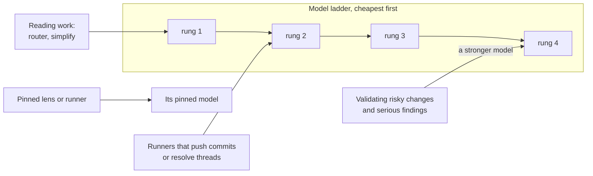

Use any provider your harness can reach. Model ids pass straight to its agent tool: `haiku` on Claude Code, `provider/model` on OpenCode.

```bash
shepherd models ladder opencode-go/deepseek-v4-flash opencode-go/glm-5.3 opencode-go/kimi-k3   # cheapest first
shepherd models pin security opencode-go/qwen3.8-max     # a lens or runner always on this model
shepherd lens add react-rules --applies '**/*.tsx' --model opencode-go/kimi-k2.7-code
shepherd models                                          # what will run
shepherd opencode-agents                                 # agents per rung and pin, for OpenCode 1.x
```



Both settings land in `.shepherd/config.yml`, or `.shepherd/lenses.yml` in a repository that has only that file (`--global` for `~/.config/shepherd/lenses.yml`). The repository's ladder wins over yours, and shepherd reads it from the default branch like the lenses. With nothing set, shepherd uses the harness's own ladder.

OpenCode 1.x subagents take no model, so `shepherd opencode-agents` prints an agent per rung and per pin to merge into `OPENCODE_CONFIG_CONTENT`; swarm then dispatches by agent name.
