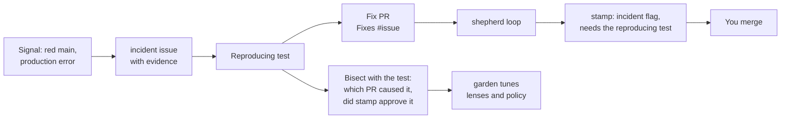

shepherd needs no spec. A failure after merge is the requirement, and the test that reproduces it is the acceptance check. `/incident` takes a red run on the default branch, an error or stack trace, an alert payload, or an issue labelled `incident`, and:



It dedupes on a fingerprint of the error, never pushes to the default branch, and stops without a fix when it cannot reproduce the failure. stamp refuses an incident fix that has no reproducing test or that hides the symptom.

`shepherd workflows` installs `shepherd-incident.yml`, which runs it when CI fails on a push to the default branch, or when you paste an error into the workflow's manual `error` input. An alerting tool (Sentry, Grafana, PagerDuty, a script) can start it too:

```bash
gh api repos/<owner>/<repo>/dispatches -f event_type=incident -F 'client_payload[error]=<error text>'
```

The payload reaches the agent as a file, never in a command. The fix PR it opens goes through the shepherd workflow and stamp like any other.

In the supplied CI workflow, the model cannot push: it hands its fix to a separate job that runs no model. That job opens the PR only from an `incident/<number>` branch whose every changed path matches `INCIDENT_PATHS` (default `^src/`). A person starts Shepherd on the resulting `incident/*` PR with `/shepherd` or the configured label. Read [GitHub Actions](/shepherd/integrations/github-actions/) before enabling alert-driven fixes.
