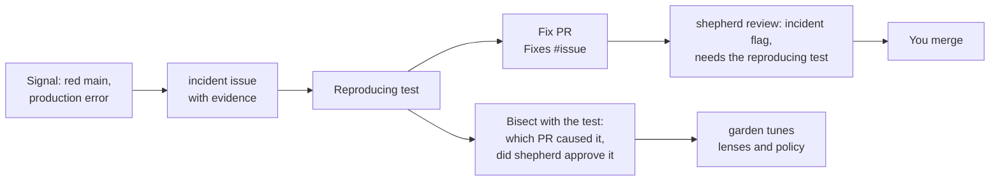

shepherd needs no spec. A failure after merge is the requirement, and the test that reproduces it is the acceptance check. `/incident` takes a red run on the default branch, an error or stack trace, an alert payload, or an issue labelled `incident`, and:

It dedupes on a fingerprint of the error, never pushes to the default branch, and stops without a fix when it cannot reproduce the failure. The review refuses an incident fix that has no reproducing test or that hides the symptom.

Run `/incident` in your coding agent with the failed run's URL, an issue, or a file holding the error. The fix PR it opens gets shepherd's review in CI like any other.
