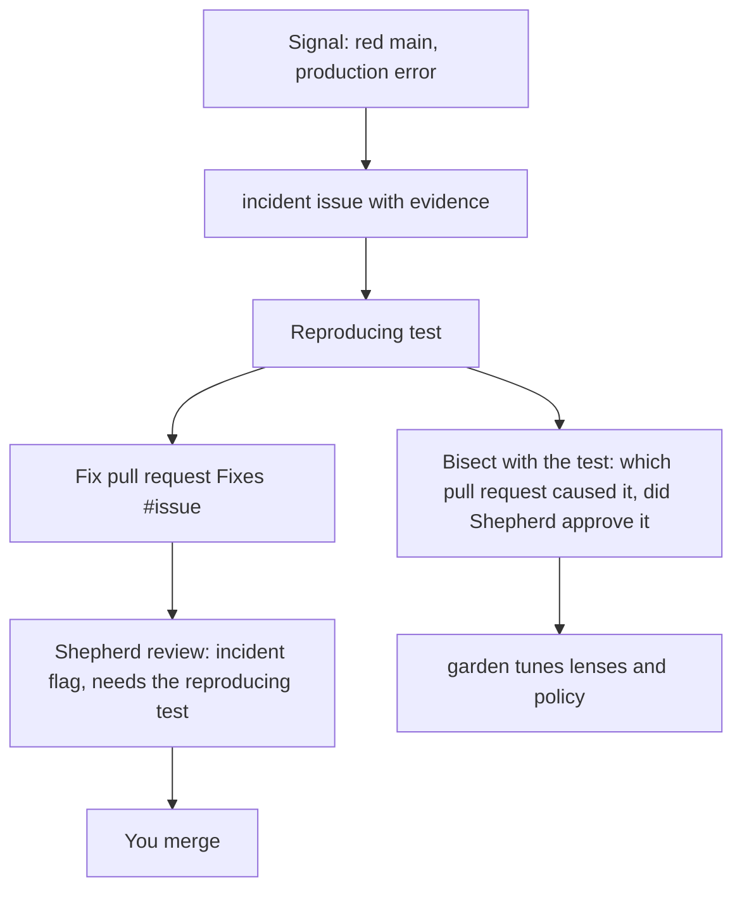

`/incident` investigates a failure after merge. You run it from your coding agent. Shepherd needs no spec for this: the failure is the requirement, and the test that reproduces it is the acceptance check.

:::caution
On a public repository, `/incident` stops on a security failure before it opens any issue or writes any test. A reproducing test for a security failure is a working exploit.
:::

## Run /incident

**1. Pick the signal**

`/incident` takes any of these as its input:

- **A red run on the default branch**: pass the failed run's URL.
- **An error or stack trace**: pass a file holding the error.
- **An alert payload**: pass a file holding the payload.
- **An issue labelled `incident`**: pass the issue.

**2. Run the command**

Run `/incident` in your coding agent with the signal:

```text
/incident <run-url|issue|error-file>
```

**3. Review and merge the fix pull request**

Shepherd's review in CI reviews the fix pull request like any other. You merge it.

## What /incident does

Shepherd works from the signal to a fix in these steps:



1. Shepherd opens an `incident` issue with the evidence.
2. It writes a test that reproduces the failure.
3. It bisects with that test to find the pull request that caused the failure, and whether Shepherd approved it. [Garden](/shepherd/operations/gardening/) uses that result to tune lenses and policy.
4. It opens a fix pull request that says `Fixes #<issue>`.

## Limits on what /incident does

`/incident` holds to these rules:

- **Duplicates**: Shepherd dedupes on a fingerprint of the error, so a repeat of the same failure doesn't open a second issue.
- **Default branch**: Shepherd never pushes to the default branch.
- **No reproduction**: if Shepherd can't reproduce the failure, it stops without a fix.
- **Review of the fix**: the review refuses an incident fix that has no reproducing test, or that hides the symptom.

## Related resources

- [Read and respond to a review](/shepherd/guides/pull-requests/): the review the fix pull request gets
- [Improve reviews with garden](/shepherd/operations/gardening/): how garden tunes lenses and policy from incidents
- [Skills and human decisions](/shepherd/reference/skills/): what the `incident` skill does
