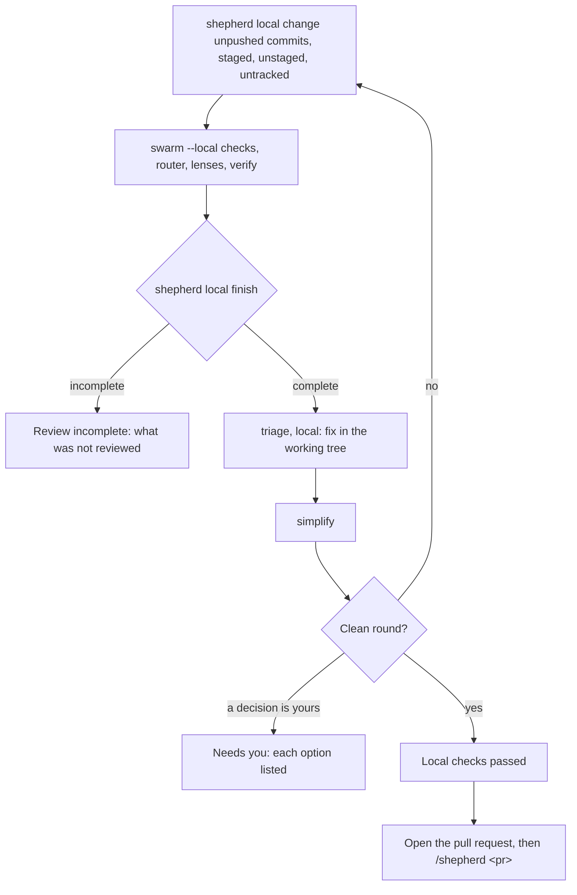

`/shepherd --local` reviews and fixes your change before it reaches GitHub. You run it from your coding agent, in the repository you're working in. It uses the same lenses, verification and fix rules as the [pull request loop](/shepherd/concepts/review-loop/).

Local mode never pushes, comments, commits or sets a status. Shepherd leaves its fixes in your working tree, and you commit them.

:::note
To review a pull request that's already open, run `/shepherd <pr>`, or see [Read and respond to a review](/shepherd/guides/pull-requests/) for the review in GitHub Actions.
:::

## Run a local review

**1. Run /shepherd --local**

Run the command in your coding agent:

```text
/shepherd --local
```

To measure the change from a different ref, add `--base <ref>`. To review without fixing anything, run `/swarm --local` instead.

**2. Let the rounds run**

Each round reviews the change, fixes findings in the working tree, then simplifies. The loop repeats until a round comes back clean, a decision needs you, or it reaches the round cap:



**3. Read the result and commit**

The run ends with one of the results in [How results are reported](#how-results-are-reported). After **local checks passed**, review the edits Shepherd made, commit them, open the pull request, and run `/shepherd <pr>`.

## What the review covers

Shepherd captures the change with `shepherd local change`. The change includes:

- **Unpushed commits**: the commits your branch has that its upstream lacks, or that the remote's default branch lacks if the branch has no upstream.
- **Staged and unstaged edits**: everything you've changed in tracked files.
- **Untracked files**: any new file `.gitignore` doesn't exclude.

Shepherd reads untracked files through a copy of the index, so your own staging stays as you left it.

## What the review reads and edits

Check these before you run a review:

- **Edits**: Shepherd fixes findings in your working tree. It doesn't commit, push, comment or set a status.
- **GitHub**: local mode makes no GitHub writes.
- **Fix rules**: the fixes follow the same rules as the pull request loop. See [Rules for reviews and fixes](/shepherd/concepts/fix-boundaries/).

## Check that the review finished

`shepherd local finish` checks each review against the change before anyone reads it as clean. It reports a review complete only if all of these hold:

- **Stages and lenses**: every stage ran, and every lens ended `ok`.
- **Coverage**: every changed line range reached at least one reviewer.
- **Finding lines**: each finding names a line its file has.
- **Check findings**: Shepherd raised each check finding, or dropped it with a reason.
- **Stable files**: the files didn't change while the review ran.

If any of these fails, the run reports **review incomplete** and lists what's missing. A complete review proves Shepherd put each line in front of a reviewer. That's less than proof the reviewer understood it.

## Check a change is still reviewed

A complete review writes a receipt keyed to a fingerprint of the exact content. To see whether the files on disk still match a reviewed change, run:

```bash
shepherd local status
```

Any edit since the review makes the status `changed`. To check before every push, wire `shepherd local status` into a pre-push hook.

## How results are reported

Local mode ends with one of these results:

- **Local checks passed**: a round came back clean.
- **Needs you**: a decision is yours, and Shepherd lists each option.
- **Review incomplete**: `shepherd local finish` found a gap, and the report names what Shepherd didn't review.
- **Round cap**: the loop stopped at its round limit.

Local mode never reports a change as merge-ready. Merge readiness belongs to the review on the pull request and its `shepherd` status.

## Try it on planted bugs

To see a local review find real bugs, create the demo repository:

```bash
bunx @jagreehal/shepherd local demo    # prints the repository path and the bugs to expect
```

The demo repository carries seven bugs across the five ways a change reaches the review: an unpushed commit, a staged edit, an unstaged edit, an untracked file and a deleted check. `examples/local-demo/expected.json` lists each bug with its lines.

## Related resources

- [Read and respond to a review](/shepherd/guides/pull-requests/): the review Shepherd posts once the pull request is open
- [Review, triage and CI repair](/shepherd/concepts/review-loop/): how a round runs, step by step
- [Rules for reviews and fixes](/shepherd/concepts/fix-boundaries/): what Shepherd will and won't change
- [Command reference](/shepherd/reference/commands/): every `shepherd local` command and its exit codes
