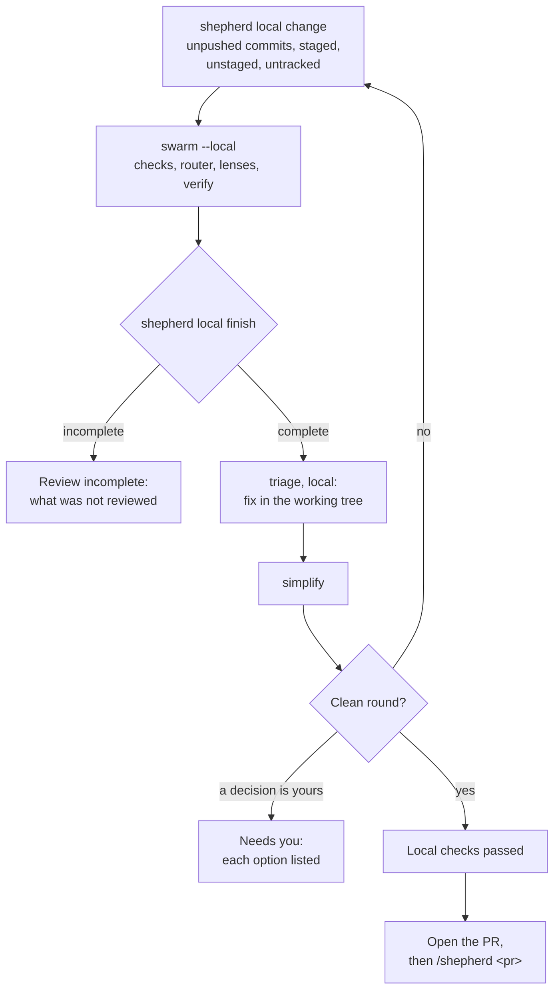

`/shepherd --local` reviews and fixes your change before it reaches GitHub. It uses the same lenses, verification and fix rules as the PR loop, and it never pushes, comments, commits or sets a status. You commit the fixes.



The change covers the commits your branch has that its upstream (or the remote's default branch) lacks, staged and unstaged edits, and untracked files `.gitignore` does not exclude. shepherd reads untracked files through a copy of the index, so your own staging stays as you left it.

`shepherd local finish` checks each review against the change before anyone reads it as clean:

- every stage ran, and every lens ended `ok`;
- every changed line range reached at least one reviewer;
- each finding names a line its file has;
- each check finding was raised or dropped with a reason;
- the files did not change while the review ran.

Anything short of that reports **review incomplete** with what is missing. It proves each line was put in front of a reviewer, which is less than proof that the reviewer understood it.

A complete review writes a receipt keyed to a fingerprint of the exact content. `shepherd local status` tells you whether the files on disk still match a reviewed change; any edit since makes it `changed`. Wire it into a pre-push hook if you want one.

Local mode ends with **local checks passed**, **needs you**, **review incomplete**, or the round cap. Merge readiness still belongs to the PR loop and stamp.

Try it on planted bugs:

```bash
bunx @jagreehal/shepherd local demo    # prints the repository path and the bugs to expect
```

The demo repository carries seven bugs across the five ways a change reaches the review: an unpushed commit, a staged edit, an unstaged edit, an untracked file and a deleted check. `examples/local-demo/expected.json` lists each one with its lines.
