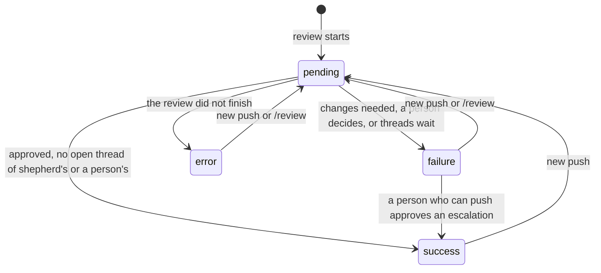

Every review in GitHub Actions sets the `shepherd` commit status on the head it reviewed.

- `pending` while the review runs, or `not reviewed: …` when the PR is a draft or lacks the trigger label.
- `success` (`approved; no open thread`) when the review approves and no thread stays open that is shepherd's or that a person wrote in.
- `failure` names the next step: `changes needed: …`, `a person decides: …`, or `approved; N open thread(s) to resolve`.
- `success` (`approved by <person>`) when the review escalated and someone who can push approved that head on GitHub, during the review or after it, with no thread of shepherd's or a person's open. Dismissing the approval sets `failure` again. GitHub sends no event when a thread is resolved, so after resolving the last one, approve again (or submit any review) and the check updates. On a PR from a fork an approval cannot change the status, because GitHub gives that event a read-only token: an escalated fork PR stays `failure`, and someone allowed to bypass the branch rule merges it.
- `error` when the review did not finish. Comment `/review` to run it again.

Shepherd posts its review as a COMMENT and never approves on GitHub. A person approves the PR.

Require the status in a branch rule, and a PR cannot merge while the review is running, refused, waiting on a person, or behind a push it has not reviewed.

`shepherd status <pr>` shows the review, the `shepherd` status, CI and open threads on the PR's head as one stage and the next step.

Run from your coding agent, `/shepherd <pr>` also sets the `shepherd` status, through your account; `/shepherd --local` sets none. Read [GitHub Actions](/shepherd/integrations/github-actions/#the-shepherd-status) for the CI side.

## Notifications

Read [PR state notifications](/shepherd/integrations/notifications/).
