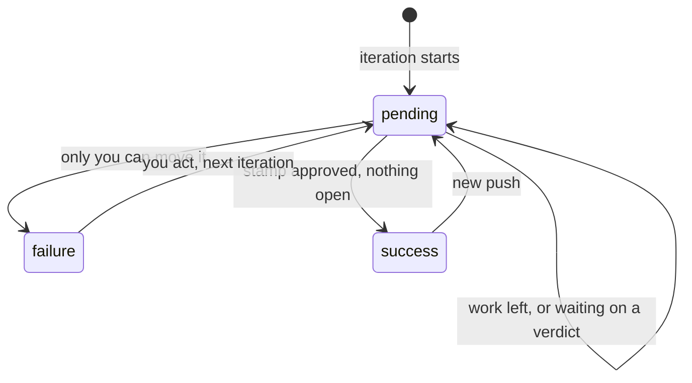

Every iteration sets a `shepherd` commit status on the head.

- `pending` while there is work or a verdict to wait for.
- `failure` names what you need to do when only you can move it (`stamp refused: ...`, `3 threads need you`).
- `success` only when stamp approved and nothing is left open.

In GitHub Actions the model writes the status it wants and the `publish` job sets it: `pending` after any push, since the new commits are not reviewed yet, and `failure` when it refuses the fixes or the PR reaches 20 shepherd commits. When nothing was pushed and no CI job was rerun, a model's `pending` becomes `failure` if the round left findings above NIT for you, and stays `pending` otherwise. See [GitHub Actions](/shepherd/integrations/github-actions/#credential-handoff).

Require the status in a branch rule, and a PR cannot merge while shepherd is mid-loop, stopped short, or behind a push it has not seen.

## Notifications

Read [PR state notifications](/shepherd/integrations/notifications/).
