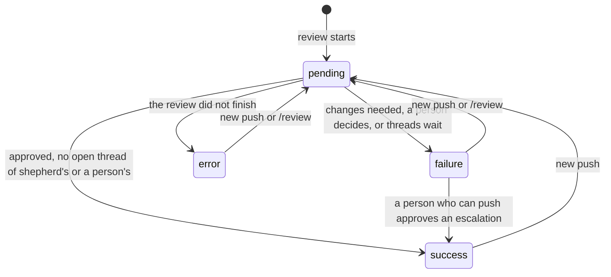

Each review in GitHub Actions sets the `shepherd` commit status on the head it reviewed. A branch rule can require it, so a pull request can't merge while its review is running, refused, waiting on a person, or behind a push Shepherd hasn't reviewed.

To read the review itself, see [Read and respond to a review](/shepherd/guides/pull-requests/).

## How the status moves

## Status states

Each state carries a description. Find the state in the first column:

| State | Description | What it means |
| --- | --- | --- |
| `pending` | `shepherd is reviewing this head` | The review is running |
| `pending` | `not reviewed: …` | Shepherd skipped a draft, or a pull request without the trigger label |
| `success` | `approved; no open thread` | The review approved, and no thread of Shepherd's or a person's is open |
| `success` | `approved by <person>` | The review escalated, and someone who can push approved the head |
| `failure` | `changes needed: …` | The review refused |
| `failure` | `a person decides: …` | The review escalated, and nobody has approved yet |
| `failure` | `approved; N open thread(s) to resolve` | The review approved, but threads are still open |
| `error` | `the review did not finish; comment /review to run it again` | The review stopped before a verdict |

## How a person settles an escalation

Someone who can push approves the head on GitHub, during the review or after it. If no thread of Shepherd's or a person's is open, Shepherd sets `success`, `approved by <person>`. These cases change that:

- **Dismissed approval**: dismissing the approval sets `failure` again.
- **Resolved threads**: GitHub sends no event for a resolved thread. After you resolve the last one, approve again or submit any review, and Shepherd updates the status.
- **Forks**: on a pull request from a fork, an approval can't change the status, because GitHub gives that event a read-only token. An escalated fork pull request stays `failure`, and someone allowed to bypass the branch rule merges it.

## Who approves

Shepherd posts its review as a COMMENT and never approves on GitHub. A person approves the pull request.

`shepherd status <pr>` shows the review, the `shepherd` status, CI and open threads on the pull request's head as one stage, with the next step.

From your coding agent, `/shepherd <pr>` also sets the `shepherd` status, through your account. `/shepherd --local` sets none.

## Related resources

- [Read and respond to a review](/shepherd/guides/pull-requests/): the review's sections, the comment commands, and reading the status from a script
- [Set up the review in GitHub Actions](/shepherd/integrations/github-actions/#the-shepherd-status): the CI side of the status
- [Send pull request state notifications](/shepherd/integrations/notifications/): send a status change to a webhook
