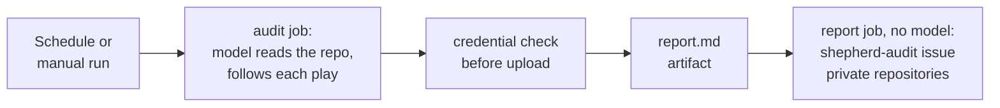

Per-PR review checks what a change breaks. Some security work reads the whole repository instead: dependency CVEs, secrets in history, infrastructure configuration. `shepherd workflows --audit` installs `shepherd-audit.yml`, which runs plays from the [OWASP Secure Agent Playbook](https://github.com/OWASP/secure-agent-playbook) (CC-BY-4.0) on the default branch every Monday, or when you start it by hand.

## Plays

The default set is `secrets-scan sca-audit iac-security-review code-review-security`. Set the `AUDIT_PLAYS` variable, or the manual run's `plays` input, to any play names in the playbook:

| Play | What it reads |
| --- | --- |
| `secrets-scan` | Credentials in files and git history |
| `sca-audit` | Dependency CVEs, with reachability |
| `iac-security-review` | Terraform, Kubernetes, CloudFormation |
| `code-review-security` | Code against the OWASP Top 10 and ASVS |
| `api-security-review` | APIs against the OWASP API Top 10 |
| `llm-risk-assess`, `agentic-ai-risk-assess`, `mcp-server-review` | LLM, agent and MCP code |

The playbook is pinned to a commit (`PLAYBOOK_SHA`), because its plays are instructions the agent follows. Bump it as a reviewed change.

## What it can write

- The audit job holds the model key and `contents: read`. Its checkouts keep no token, and it writes one report file.
- Before anything is uploaded, the audit job checks the report for credential shapes (an AWS key, a GitHub token, an API key, a Slack token, a private key block). A match deletes the report, names the kind of credential, never its value, and fails the run: rerun the `secrets-scan` play locally and rotate what it finds.
- The report job runs no model. On a private repository it files one issue labelled `shepherd-audit` and comments on it each week.
- On a public repository issues and artifacts are public, so the audit runs there only when the `AUDIT_PUBLIC` variable is `true`. The report then becomes a public artifact and no issue is filed.

## Per-PR review

The same playbook feeds two bundled lenses, `owasp-asvs` and `owasp-llm`, which review each PR's diff. See [Compose reviews for your stack](/shepherd/configuration/stacks/).
