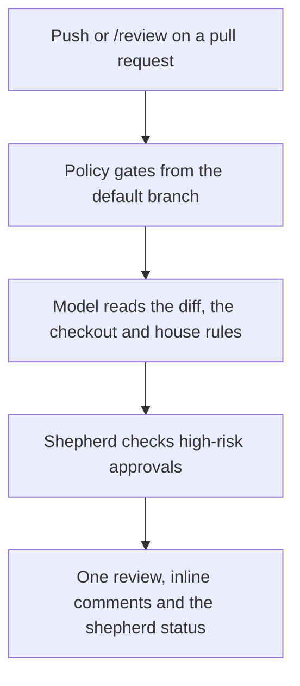

Shepherd reviews the pull requests in your GitHub repositories. On each push, a model reads the change alongside the surrounding code and your team's rules, and looks for bugs, security holes and broken callers. Shepherd posts one review with a verdict and an inline comment per finding, then sets the `shepherd` commit status on the head it reviewed.

Shepherd never approves a pull request on GitHub. A person approves and merges, and a branch rule can require the `shepherd` status before anyone merges.

:::note
Shepherd uses AI to review code and may miss bugs, security holes or other problems. An approval means the review found nothing to block on. It doesn't mean your code is correct or secure.
:::

To turn on reviews in CI, follow [Set up the review in GitHub Actions](/shepherd/integrations/github-actions/). Shepherd's skills also run in your coding agent, where they review a change before you open a pull request, fix findings, and repair CI. See [compare the options](#compare-ways-to-get-a-review).

## Set up and use Shepherd

Pick the page for what you need to do:

| You want to | Read |
| --- | --- |
| Review each pull request in CI | [Set up the review in GitHub Actions](/shepherd/integrations/github-actions/) |
| Read a review on your pull request and respond to it | [Read and respond to a review](/shepherd/guides/pull-requests/) |
| Change what the review flags | [Customize Shepherd for your team](/shepherd/start/customize/) |
| Review and fix from your coding agent | [Run your first review](/shepherd/start/quickstart/) |
| Check a change before you open a pull request | [Review before opening a pull request](/shepherd/guides/local-review/) |
| Fix a review that didn't start or didn't finish | [Troubleshoot a review or repair](/shepherd/operations/troubleshooting/) |
| Estimate and cap what reviews cost | [Review costs](/shepherd/operations/costs/) |

## Requirements

Check that you have these before you set up Shepherd:

- **Code host**: a repository on GitHub, with GitHub Actions turned on.
- **Model**: a key for a model provider, stored as an Actions secret. Shepherd works with OpenCode, Anthropic, OpenAI, OpenRouter and Amazon Bedrock. [Environment and credentials](/shepherd/reference/environment/) lists each one.
- **Setup machine**: Bun and an authenticated GitHub CLI (`gh`), to run `shepherd init`.
- **Coding agent** (optional): an agent that loads skills and runs subagents, such as Claude Code or OpenCode, for the local skills.

You don't need a GitHub App or a personal access token. The workflow uses the job's own `github.token`.

## How a review works

By default, the review looks for changes that would break production: wrong results, security holes, data loss, wrong charges and broken callers. It doesn't report formatting or style. To change what it flags, [add your team's rules](/shepherd/start/customize/).

A review runs on your own GitHub Actions runner, in four stages:

1. **Gate**: Shepherd reads its policy from the default branch and checks the changed paths against it. A change to a path in a `deny` category, or to Shepherd's own policy, goes to a person whatever the model says.
2. **Review**: the model reads the diff, the checkout, your house rules (`AGENTS.md`, `CLAUDE.md`, `REVIEW.md`, `CONTRIBUTING.md`, `CODING_STANDARDS.md`) and your team's lenses, all from the default branch. It returns a verdict, a merge risk and its findings.
3. **Check**: an approval has to name the fact that makes the change safe. Shepherd escalates a high-risk approval that rests on an unchecked fact. With a second backend configured (`backends` under `review:`), a medium- or high-risk approval also needs the second model to agree, and Shepherd escalates a disagreement.
4. **Post**: Shepherd posts the review, resolves the threads a push settled, and sets the `shepherd` status.

Each review leaves these on the pull request:

- **A review**: posted as a COMMENT, with the verdict in its heading (`✅ shepherd: APPROVED`, `❌ shepherd: REFUSED` or `🙋 shepherd: ESCALATE`), then the merge risk, a summary of the change, and the findings.
- **Inline comments**: one per finding, on the lines concerned.
- **The `shepherd` commit status**: `success`, `failure` with the author's next step, or `error` if the review didn't finish.
- **An evidence artifact**: `gate-evidence-<pr>` on the workflow run, holding the review's evidence as JSON.

Each comment Shepherd posts starts with shepherd's icon and `Automated comment by`, so you can tell it from a person's comment.

### Verdicts

Each review ends with one of three verdicts:

| Verdict | What it means | What happens next |
| --- | --- | --- |
| ✅ APPROVED | The review found nothing to block on | The status turns `success` once no thread of Shepherd's or a person's is open |
| ❌ REFUSED | A finding blocks approval | The author fixes the code and pushes, and Shepherd reviews the new head |
| 🙋 ESCALATE | A person has to decide | Someone who can push approves the head, and the status turns `success` |

After three refusals on one pull request, Shepherd escalates the next one instead, so a person can reconsider the approach. [Read and respond to a review](/shepherd/guides/pull-requests/) covers each verdict.

### What a review can access

The review job reaches your code and GitHub in these ways:

- **Where it runs**: in your repository's GitHub Actions, on a GitHub-hosted runner, with the model provider you choose. Your code goes to that provider and nowhere else.
- **What the model reads**: the checkout, through read, grep and glob tools. The model runs no shell, never builds or runs the pull request's code, and holds no token.
- **What it writes**: nothing. Shepherd's own process makes each GitHub write after the model returns. The job that holds the model keys has `contents: read`. A second job, with no keys and nothing installed, resolves threads and sets the final status.

[What the model can do](/shepherd/integrations/github-actions/#what-the-model-can-do) lists the permissions each job holds.

### Who controls a review

Your repository's settings and your default branch decide each of these:

- **Who can start one**: opening, pushing to, reopening or marking a pull request ready starts a review, except on drafts. A `/review` comment starts one only if the commenter can push to the repository.
- **Which rules it follows**: the policy, house rules and lenses on the default branch. A pull request can't loosen the review it gets, and Shepherd sends any edit to `.shepherd/config.yml` to a person.
- **Who approves**: a person. Shepherd never approves on GitHub. Keep **Allow GitHub Actions to create and approve pull requests** turned off.

## Compare ways to get a review

To find the option that fits, compare what starts each one and what it may change:

| Option | What starts a review | Where it runs | What it changes |
| --- | --- | --- | --- |
| [Review in GitHub Actions](/shepherd/integrations/github-actions/) | A push, a pull request marked ready, or a `/review` comment | Your Actions runner | Nothing |
| [`/shepherd <pr>`](/shepherd/start/quickstart/) | You run it in your coding agent | Your machine | Nothing, your working tree, or the pull request branch, as `fixes.mode` allows |
| [`/shepherd --local`](/shepherd/guides/local-review/) | You run it before you open a pull request | Your machine | Your working tree only. It doesn't commit or push |
| [`shepherd gate <pr> --dry-run`](/shepherd/reference/commands/) | You run it from the terminal | Your machine | Nothing, and it posts nothing |

The review in CI and the local skills read the same policy and lenses. If your repository also runs Claude Code Review, keep one `REVIEW.md` for both: Shepherd [reads it the same way](/shepherd/integrations/github-actions/#reviewmd-as-claude-code-review-reads-it).

## Related resources

- [Choose a setup](/shepherd/start/choose-a-setup/): local review, a pull request loop, or CI
- [Rules for reviews and fixes](/shepherd/concepts/fix-boundaries/): what Shepherd will and won't do
- [Configuration reference](/shepherd/reference/configuration/): each key in `.shepherd/config.yml`
