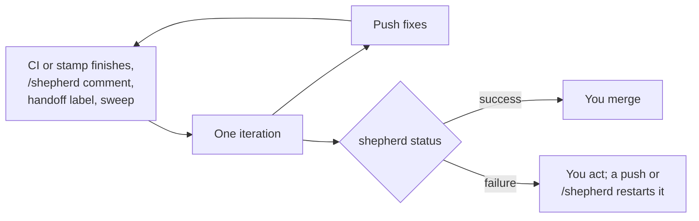

`/loop` stops when your laptop sleeps. To keep the loop going without it, install the workflows:

```bash
bunx @jagreehal/shepherd workflows    # .github/workflows/shepherd.yml and shepherd-incident.yml
```

The command copies both templates into `.github/workflows`, keeps any file already there, and pins `SHEPHERD_VERSION` in each to the version that wrote it. The jobs install that CLI version on `PATH`, so later skill commands use the same release. Name your CI workflow in each file's `workflows:` list (`[ci, stamp]` in `shepherd.yml`, `[ci]` in the incident file), add the `SHEPHERD_TOKEN` and `OPENCODE_API_KEY` secrets, and merge.



- An iteration starts when CI or stamp finishes on a PR from this repository, on a `/shepherd` comment from an owner, member or collaborator, when the PR gets the handoff label, or from a manual run with a `pr` input. Every 30 minutes a sweep dispatches an iteration for each open, non-draft PR from this repository whose `shepherd` status is still `pending`. With a handoff label set, it also dispatches labelled PRs shepherd has never touched.
- **Handoff label:** set the `SHEPHERD_LABEL` variable and shepherd takes only PRs that carry it. Whatever opens PRs (a person, Claude Code, Codex, another agent or pipeline) hands one over by adding the label. A `/shepherd` comment always runs.
- An iteration skips closed PRs, forks, drafts, PRs without the handoff label, PRs whose author lacks write access, a PR whose head branch is the default branch, and `incident/*` branches until a person comments `/shepherd` or adds the label. When CI or stamp finishing starts it, it also skips a head where shepherd already set `success` or `failure`. After 20 shepherd commits on the PR it sets `failure` and stops for a person.
- The workflows run from the default branch, so a PR cannot change how it is shepherded.

## Credential handoff

The model reads text anyone can write: comments, review threads, bot output. So the PR workflow never gives it a write credential. It has four jobs. Read the [handoff contract](https://github.com/jagreehal/shepherd/blob/main/skills/shepherd/SKILL.md#handoff-mode) if you customise them.

| Job | Model | Credential | Does |
| --- | --- | --- | --- |
| `sweep` | No | `github.token` | On the schedule, dispatches PRs left `pending`; the gate drops a dispatched run whose head has stopped being `pending` |
| `gate` | No | `SHEPHERD_TOKEN` | Decides whether to run (the skips above) and passes the branch, base, starting head and Git identity to the next jobs |
| `iterate` | Yes | `github.token` | Runs one iteration in handoff mode and bundles its commits |
| `publish` | No | `SHEPHERD_TOKEN` | Runs after every iteration, failed or not: checks and pushes the bundle, sets the status, reruns jobs and notifies |

`iterate` gets `github.token` with `contents: read` and write access to pull requests and issues only. Its checkout does not persist credentials. `SHEPHERD_TOKEN` appears nowhere in the job: a secret that any step uses sits in the job's runner memory, where a hijacked model step could read it. `src/workflow.test.ts` pins these properties. The job sets `SHEPHERD_HANDOFF`, so the skill commits fixes, writes `status.json` and never pushes. It runs OpenCode 1.19.0. Commits go out under the `SHEPHERD_TOKEN` owner's name; comments post as `github-actions[bot]`, which stamp counts as automated and leaves out of its review.

Add your project's dependency installation to `iterate` where the template marks it, with install scripts off and no dependency cache (`npm ci --ignore-scripts`; `setup-node` without `cache:`). A cache this job saved would reach every later run on the default branch. `oven-sh/setup-bun` is pinned to a commit in both templates.

Runs for one PR never overlap: the whole workflow, gate to publish, holds a per-PR concurrency group keyed on the gate's own condition. A run that its event alone rules out gets a group of its own. A run the gate step skips after reading GitHub (finished head, label scope, incident branch) still queues in the PR's group, where GitHub keeps one waiting run, so comment `/shepherd` again when a queued request did not start. The gate marks the head `pending` before the model starts, so a rerun never leaves an older green standing. If the iteration fails or times out, `publish` still runs and, before any setup of its own, sets `error` on the starting head (`shepherd iteration failure; comment /shepherd to retry`), linking the run. If any `publish` step fails (checkout, push or status), its last step sets `error` the same way, so the sweep never reruns the model on a stuck `pending`.

`publish` runs no model and executes nothing the model wrote: it fetches the bundle and checks it. It pushes only when:

- the PR branch is neither the default branch nor the PR's base;
- the PR head is still the starting head. If someone pushed first, it pushes nothing and leaves the status alone; the next iteration starts from the new head;
- the commits are a fast-forward of the starting head;
- no path the fixes changed matches `SHEPHERD_PUSH_DENY` or contains a control character. A path counts only when it differs from both the starting head and the base, so a base merge's own changes pass.

A refusal sets `failure` with `fixes not pushed, a person should look:` and the reason. Otherwise it sets the status from `status.json`, keeping only a known state and one line of text; after any push the status is `pending`, because the new commits have not been reviewed. It reruns a job ci-repair asked for only when that job ran on this PR's head from a `pull_request` event. Then it runs `shepherd notify`.

`SHEPHERD_PUSH_DENY` is an extended regex matched case-insensitively. The default refuses `.github/`, `.gitmodules`, `.gitattributes`, the `.husky`, `.githooks`, `.devcontainer` and `.vscode` directories, `.npmrc`, `.yarnrc`, `.yarnrc.yml`, `.pnpmfile.cjs`, `package.json`, `bunfig.toml`, other manifests (`go.mod`, `Cargo.toml`, `build.rs`, `pyproject.toml`, `setup.py`, `setup.cfg`, `requirements*.txt`, `Gemfile`, `composer.json`, `pom.xml`, Gradle build and settings files), lockfiles by name and extension (`*.lock`, `*.lockb`, `*-lock.json`/`.yaml`/`.yml`/`.hcl`/`.toml`, `*.lock.json` and the like, `*.lockfile`, `npm-shrinkwrap.json`, `go.sum`, `Package.resolved`; source files such as `clock.ts` or `file-lock.ts` pass), makefiles, justfiles, Taskfiles, `.pre-commit-config.yaml`, `.cargo/`, `pnpm-workspace.yaml`, `Pipfile` and `deno.json(c)`. Read the exact regex in the generated template before you change this boundary.

What remains is what `github.token` allows in `iterate`: a hijacked model can comment, resolve threads, edit the PR description, and write a misleading `status.json`. It cannot push code, and it cannot set a `success` status on commits it handed off.

## Incident workflow

The `investigate` job runs the model with `contents: read` and `issues: write`, and no persisted checkout credential: it can read code and file an issue. It hands a fix branch as a Git bundle to the `open` job, which runs no model. `open` requires a branch named `incident/<number>` that shares history with the default branch, refuses an empty change, and requires every changed path to match `INCIDENT_PATHS` before it pushes and opens the PR with `SHEPHERD_TOKEN`. `INCIDENT_PATHS` is an extended regex; the default is `^src/`. A project with tests outside `src/` must review and configure a suitable pattern before it expects those fixes to publish.

`investigate` holds a job-level concurrency group, so incidents run one at a time and a repeat signal dedupes against the first. An `incident/*` PR waits for a person's `/shepherd` comment or the handoff label before the PR workflow starts. You can submit an incident through a failed CI run from a push to the default branch, `repository_dispatch` with type `incident`, or the incident workflow's manual `error` input.

## Verify the first CI iteration

Match each template's `workflows:` names to the names of your CI and Stamp workflows. Add the project dependency installation steps where the template marks them. Set the required secrets, merge the workflows, then start a test PR with the configured label or comment.

Inspect the gate step first. It prints `skip:` with the reason: draft, fork, missing label, author permission, finished head, incident branch or commit cap. Then inspect the model step and the `publish` job. Confirm the pushed head and commit status refer to the same commit. A stopped model or a refused bundle needs inspection; it is not a completed review.
