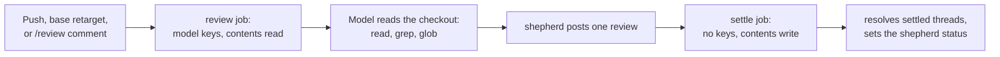

Shepherd reviews every PR in GitHub Actions with one workflow and one job. Install it:

```bash
bunx @jagreehal/shepherd workflows --model bedrock:minimax.minimax-m2.5 --aws-region eu-west-1 --environment ai-review
```

That writes `.github/workflows/shepherd.yml`, pins the model in `.shepherd/config.yml`, and adds the reviewer's policy under `review:` in the same file. Add the model key as a secret under the provider's own name (`OPENCODE_API_KEY`, `ANTHROPIC_API_KEY`, `AWS_BEARER_TOKEN_BEDROCK`...), merge, and every PR gets a review. No personal access token and no GitHub App are needed.

- **`--model`** writes the model to `.shepherd/config.yml` as `models.loop`, so it is reviewed and versioned with the rest of the policy and read from the default branch. The `SHEPHERD_MODEL` variable overrides it, and `model:` under `review:` overrides `models.loop`. Use the variable to try a model without a PR.
- **`--environment <name>`** runs the review job in that GitHub environment. Store the model keys as its secrets, not repository secrets.
- **`--aws-region`** sets the Bedrock region.

The command keeps a `shepherd.yml` that exists. `--upgrade` rewrites it from the current template, keeping its environment, OIDC and region choices, and pins `SHEPHERD_VERSION` to the CLI's version.

## What runs



The job runs on `pull_request` (opened, pushed, reopened, ready for review, and an edit that retargets the base) and on a `/review` comment from someone who can push. `/gate` works too. Shepherd asks GitHub's permission API whether the commenter can push, so access through a team counts; anyone else's comment changes nothing. A newer run on the same PR cancels the one in flight.

Draft PRs and, when `review.label` is set, PRs without that label are skipped, and the skip resets the `shepherd` status. The policy is read from the default branch, so a PR cannot change the rules it is reviewed against. On `pull_request` GitHub runs the workflow file from the PR itself, so a PR that edits `shepherd.yml` runs its own edit. CODEOWNERS on `/.github/` is what makes a person sign off on that (see below).

## What the model can do

The model reads the checkout through read, grep and glob. It runs no shell, never executes PR code and holds no token. Shepherd's own process makes every GitHub write after the model returns.

The work is split in two jobs, so the job holding the model keys cannot change code:

| Job | Permissions | Does |
| --- | --- | --- |
| `review` | `contents: read`, `pull-requests: write`, `statuses: write`, and reads of `issues`, `actions`, `checks` | Holds the model keys. Posts the review and sets the status to `pending` |
| `settle` | `contents: write`, `pull-requests: write`, `statuses: write` | No keys, no checkout, nothing installed: only the `gh` on the runner. Resolves the threads the review settled, reading each one again first, then sets the final status |

GitHub requires `contents: write` to resolve a review thread, which is why `settle` exists. The checkout persists no credentials. `oven-sh/setup-bun` is pinned to a commit.

The `review` job can still set the `shepherd` status, so the package it runs is what you trust. Shepherd publishes as one bundled file with no dependencies: `bunx` fetches shepherd and nothing else, at the version `SHEPHERD_VERSION` pins. Keep **Settings → Actions → General → Allow GitHub Actions to create and approve pull requests** off, so the job's token cannot approve a PR.

## What it reads

The review reads the PR's diff and the checkout, and your house rules: `AGENTS.md`, `CLAUDE.md`, `REVIEW.md`, `CONTRIBUTING.md` and `CODING_STANDARDS.md`, from the default branch. Each changed file brings the ones at the root and in every directory above it, so `ui/REVIEW.md` adds rules for `ui/` and wins where it disagrees with the root, and a Markdown file one of them links to inside the repository is read too. A PR that edits any of them is reviewed against the old version, and a file that only points at another (`CLAUDE.md` as a symlink to `AGENTS.md`) is read once. A change that breaks a rule from a `REVIEW.md` above the changed file, or from a file or skill the root one includes, gets a line comment quoting the rule, on an approval too, so triage can fix it; until it is fixed the open thread holds the `shepherd` check. A stacked PR is the exception: its review reads the change over the PR it is stacked on, which GitHub cannot anchor a line comment to, so its breaches are listed in the review only. A breach of the other files gets a note. `REVIEW.md` also steers what the review reports: its paths to skip, caps and format apply to notes and standards, never to a blocking issue. It is the same file Claude Code Review reads, so a repository running both keeps one. A PR that adds a skip or a cap escalates to a person. Either way the verdict stays the review's own: a missing doc comment never refuses a merge. A rule you want enforced belongs in a lens under `.shepherd/`, where its `gate` decides whether a breach refuses or escalates.

### `REVIEW.md`, as Claude Code Review reads it

Shepherd reads `REVIEW.md` the way [Claude Code Review](https://code.claude.com/docs/en/code-review-customize) does, so one file steers both, and `AGENTS.md` and `.agents/skills/` work for teams whose agents are not Claude:

- **Includes.** A line in the root `REVIEW.md` holding only `@review-security.md` puts that file, saved beside `REVIEW.md`, in place of the line. `@.claude/skills/<folder>/SKILL.md` or `@.agents/skills/<folder>/SKILL.md` puts in a skill's body, without its frontmatter, and a line that would inject a command's output (`` !`cmd` ``) says it was not run. Includes go one level deep and only from the root file. An `@` line in a fenced or indented code block (a fence closes only on a bare run of its own character at least as long as the opening one), an HTML comment or a `<pre>`, `<script>`, `<style>` or `<textarea>` block, one with a space or a subdirectory path, or one naming no file stays as text.
- **Limits.** At most eight included files and eight skill lines (a repeated line counts again); a skill of at most 30,000 bytes, committed as a regular file, not a symlink; `REVIEW.md` and its includes under 150,000 bytes together, an include that would reach it skipped whole, and a root `REVIEW.md` that reaches it alone skipped entirely; at most 64 Markdown links across them, not counting `http`, `https`, `mailto` and `#` links, links in code, comments or `<pre>` blocks, or links in skills, past which the whole root `REVIEW.md` is skipped. Subdirectory `REVIEW.md` files share 150,000 bytes.
- **Skipped subdirectories.** A `REVIEW.md` in or below a `test`, `tests`, `__tests__`, `testdata`, `fixtures`, `__fixtures__`, `golden`, `corpus`, `snapshots`, `__snapshots__`, `example`, `examples`, `sample`, `samples`, `demo`, `demos`, `generated`, `vendor`, `third_party`, `third-party`, `thirdparty`, `node_modules`, `bower_components`, `external`, `extern`, `deps`, `godeps`, `pods`, `carthage`, `site-packages` or `contrib` directory (whole name, any case) does not apply.
- **What it may change.** Paths to skip, caps and a lower severity apply to notes and standards, never to a blocking issue, and never from a skill's text. Anything a limit left out is listed in the review under **House rules not fully applied**, as is a house rule other than `REVIEW.md` that does not fit the 24,000 characters those files share; `REVIEW.md` files are bounded by the limits above alone.
- **Where it is read from.** Always the default branch, whatever the PR's base and its branch protection; a PR that edits `REVIEW.md`, a file it includes or the file it is a symlink to is reviewed against the old version and flagged. Unlike Code Review, shepherd also reads the Markdown files a house rule links to.


Merge risk says what merging the head as it stands could break: high for data loss, a security hole, a wrong charge or broken callers, medium for a contained bug or a risk the review could not verify. A refusal or an escalation reads at least medium.

## What it posts

One review per push, always as a COMMENT. A person approves the PR on GitHub.

- The heading carries the verdict: `✅ shepherd: APPROVED`, `❌ shepherd: REFUSED` or `🙋 shepherd: ESCALATE`, then what changed.
- Each finding is an inline comment that opens with `❌ **Blocks approval** · **<short title>**` or `🙋 **Needs a person**`. The comment sits on its line, so it does not repeat the file and line.

Each run reviews the head from scratch, and keeps the threads steady across pushes:

- A shepherd thread resolves once the push changed the code under or near it. What the review raises there now posts fresh, on the new code.
- On code nobody touched, a finding of the same grade near an open shepherd thread posts nothing new. The thread stays, with its history. A finding the model does not repeat there stays open for a person to resolve.
- A thread anyone else wrote in stays open. Open shepherd threads hold an approval back.

## The `shepherd` status

A branch rule can require it.

| State | Description |
| --- | --- |
| `pending` | The review is running, or `not reviewed: …` for a draft or a PR without the trigger label |
| `success` | `approved; no open thread`, or `approved by <person>` after an escalation |
| `failure` | `changes needed: …`, `a person decides: …`, or `approved; N open thread(s) to resolve` |
| `error` | The review did not finish; comment `/review` to run it again |

The job fails only when the review did not finish. A refusal or escalation is a `failure` status on a green job.

An escalation (`a person decides: …`) is settled by a person: once someone who can push has approved the head the review read, the `settle` job sets the status to `success`, `approved by <person>`. It runs after every review and on every person's review, and reads the PR as it is: an approval given while the review was still running counts, the latest decision of each person counts (a dismissal takes the approval back), and a thread of shepherd's or a person's still open keeps it `failure` until it is resolved and someone approves again. A refusal is not settled this way: the author changes the code. On a PR from a fork, GitHub gives the review event a read-only token, so an approval cannot set the status: an escalated fork PR stays `failure`, and someone allowed to bypass the branch rule merges it.

## Who owns shepherd's setup

An edit to `.shepherd/config.yml` always escalates under `gate_policy`, so a person decides it. Workflows are yours to guard: `shepherd init` suggests CODEOWNERS entries for `/.shepherd/` and `/.github/`, and `shepherd doctor` says when one is missing or "Require review from Code Owners" is off.

## Move from the older workflows

Run `shepherd workflows --upgrade` (or `shepherd gate init --upgrade`). It rewrites `shepherd.yml`, moves `.shepherd/gate.yml` under `review:` in `.shepherd/config.yml` and deletes it once the new file reads back, and prints which older workflow files to delete: `shepherd-gate.yml`, `shepherd-gate-edited.yml`, `shepherd-gate-actions.yml`, `shepherd-incident.yml` and `shepherd-audit.yml`. Delete them, and the `SHEPHERD_TOKEN` secret if you set one.

## Verify the first review

Merge the workflow and policy, then open a test PR or comment `/review` on one. Confirm the run posts one review and sets the `shepherd` status on the PR's head. The run's `gate-evidence-<pr>` artifact holds the review's evidence as JSON.
