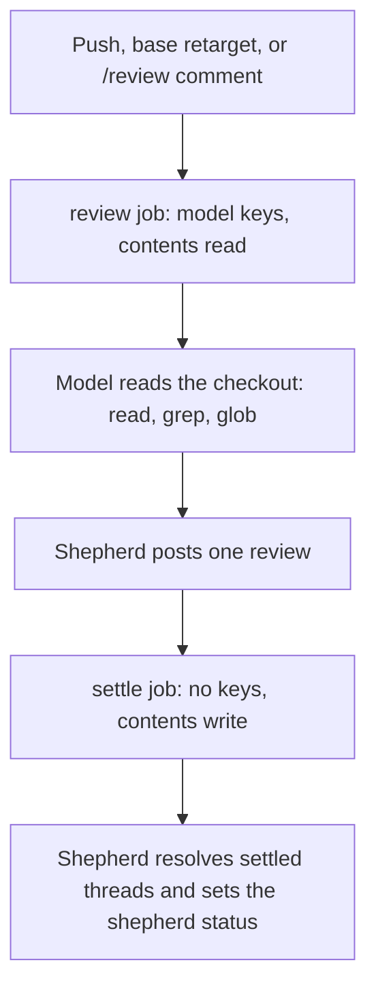

Shepherd reviews each pull request in your repository with one GitHub Actions workflow. The workflow runs on your own runners with the job's `github.token` and a model key you store as a secret, so you don't install a GitHub App or create a personal access token.

After setup, Shepherd reviews each push and sets the `shepherd` status. To read and respond to those reviews, send your developers [Read and respond to a review](/shepherd/guides/pull-requests/).

## What you need

Make sure you have this access, or someone who does:

| Access | Needed for |
| --- | --- |
| Admin on the repository | Adding the model key as an Actions secret, and setting the branch rule |
| Bun and an authenticated GitHub CLI (`gh`) | Running `shepherd init` from a clone of the repository |
| A model key: `OPENCODE_API_KEY`, `ANTHROPIC_API_KEY`, `OPENAI_API_KEY`, `OPENROUTER_API_KEY`, or Bedrock credentials | The review itself. [Environment and credentials](/shepherd/reference/environment/) lists each provider |

## Set up the review

**1. Write the workflow and policy**

From a clone of the repository, with the model key in your environment, run:

```bash
bunx @jagreehal/shepherd init
```

`init` picks the model from your key, writes `.github/workflows/shepherd.yml` and `.shepherd/config.yml`, and sets the key as an Actions secret. To choose the model yourself, add `--model provider/model`.

For a key stored in a GitHub environment, or a model on Bedrock, use `workflows` instead, and add the key as a secret yourself under the provider's own name:

```bash
bunx @jagreehal/shepherd workflows --model bedrock:minimax.minimax-m2.5 --aws-region eu-west-1 --environment ai-review
```

`workflows` takes these options:

- **`--model`**: writes the model to `.shepherd/config.yml` as `models.loop`, so you review and version it with the rest of the policy, and Shepherd reads it from the default branch. The `SHEPHERD_MODEL` variable overrides it, and `model:` under `review:` overrides `models.loop`. To try a model without a pull request, set the variable.
- **`--environment <name>`**: runs the review job in that GitHub environment. Store the model keys as the environment's secrets, not repository secrets.
- **`--aws-region`**: sets the Bedrock region.

Both commands keep files that already exist. To regenerate the workflow, run `shepherd workflows --upgrade`: it rewrites `shepherd.yml` from the current template, keeps its environment, OIDC and region choices, and pins `SHEPHERD_VERSION` to the CLI's version.

**2. Merge the files**

Commit `.github/workflows/shepherd.yml` and `.shepherd/config.yml`, and merge them into the default branch. Shepherd reads its policy from there, never from a pull request.

**3. Guard the setup**

Protect the files Shepherd trusts:

- **CODEOWNERS**: add entries for `/.github/` and `/.shepherd/`, and turn on **Require review from Code Owners**. `shepherd init` suggests the entries.
- **Required status**: add `shepherd` to the default branch's required status checks. A pull request then can't merge while its review is running, refused, waiting on a person, or behind a push Shepherd hasn't reviewed.
- **Approval setting**: keep **Settings → Actions → General → Allow GitHub Actions to create and approve pull requests** turned off, so the job's token can't approve.

**4. Check the setup**

Run:

```bash
shepherd doctor
```

Fix each line marked `fail`. `doctor` checks for the workflow, whether the model's key is a repository secret, and whether CODEOWNERS covers both directories.

**5. Verify with a test pull request**

Open a pull request that isn't a draft, or comment `/review` on an open one. Within a few minutes, the `shepherd` workflow run posts one review and sets the `shepherd` status on the pull request's head. The run's `gate-evidence-<pr>` artifact holds the review's evidence as JSON.

If no review appears, see [A review didn't run](/shepherd/operations/troubleshooting/#a-review-didnt-run).

## What runs



GitHub starts the workflow on these events:

- **`pull_request`**: opened, pushed, reopened, marked ready for review, and an edit that retargets the base branch.
- **A `/review` or `/gate` comment**: from someone who can push. Shepherd asks GitHub's permission API, so access through a team counts, and it ignores anyone else's comment.

A newer run on the same pull request cancels the one in flight.

Shepherd skips drafts and, if `review.label` is set, pull requests without that label, and resets the `shepherd` status to say why. Shepherd reads its policy from the default branch, so a pull request can't change the rules Shepherd reviews it against.

:::caution
On `pull_request`, GitHub runs the workflow file from the pull request itself, so a pull request that edits `shepherd.yml` runs its own edit. CODEOWNERS on `/.github/` makes a person sign off on that edit. See [Who owns Shepherd's setup](#who-owns-shepherds-setup).
:::

## What the model can do

The model reads the checkout through read, grep and glob tools. It runs no shell, never executes the pull request's code, and holds no token. Shepherd's own process makes each GitHub write after the model returns.

Shepherd splits the work across two jobs, so the job that holds the model keys can't change code:

| Job | Permissions | What it does |
| --- | --- | --- |
| `review` | `contents: read`, `pull-requests: write`, `statuses: write`, and reads of `issues`, `actions` and `checks` | Holds the model keys. Posts the review and sets the status to `pending` |
| `settle` | `contents: write`, `pull-requests: write`, `statuses: write` | Holds no keys and no checkout, and installs nothing: it uses only the `gh` on the runner. Reads each thread again, resolves the threads the review settled, then sets the final status |

GitHub requires `contents: write` to resolve a review thread, so Shepherd gives that permission to `settle` alone. The checkout persists no credentials, and the workflow pins `oven-sh/setup-bun` to a commit.

The `review` job can still set the `shepherd` status, so you trust the package it runs. Shepherd publishes as one bundled file with no dependencies: `bunx` fetches Shepherd and nothing else, at the version `SHEPHERD_VERSION` pins.

## What it reads

The review reads the pull request's diff, the checkout, and your house rules from the default branch: `AGENTS.md`, `CLAUDE.md`, `REVIEW.md`, `CONTRIBUTING.md` and `CODING_STANDARDS.md`.

Shepherd picks the files for each changed file this way:

- **Nearest wins**: each changed file brings the house rules at the root and in each directory above it. `ui/REVIEW.md` adds rules for `ui/` and wins where it disagrees with the root.
- **Linked files**: Shepherd also reads a Markdown file inside the repository that one of them links to.
- **Edited rules**: Shepherd reviews a pull request that edits a house rule against the old version.
- **Pointers**: Shepherd reads a file that only points at another, such as `CLAUDE.md` as a symlink to `AGENTS.md`, once.

Shepherd handles a breach by the file it comes from:

- **`REVIEW.md` breach**: a breach of a rule from a `REVIEW.md` above the changed file, or from a file or skill the root one includes, gets a line comment quoting the rule, on an approval too, so triage can fix it. Until someone fixes it, the open thread holds the `shepherd` check. On a stacked pull request, Shepherd reviews the change over the pull request it's stacked on, which GitHub can't anchor a line comment to, so Shepherd lists those breaches in the review only.
- **Other house rules**: a breach gets a note.

`REVIEW.md` also steers what the review reports. Its paths to skip, caps and format apply to notes and standards findings, never to a blocking issue. Shepherd reads the same file Claude Code Review reads, so a repository running both keeps one. If a pull request adds a skip or a cap, Shepherd escalates it to a person.

A house rule never changes the verdict: a missing doc comment never refuses a merge. To enforce a rule, write it as a lens under `.shepherd/`, where its `gate` decides whether a breach refuses or escalates.

### `REVIEW.md`, as Claude Code Review reads it

Shepherd reads `REVIEW.md` the way [Claude Code Review](https://code.claude.com/docs/en/code-review-customize) does, so one file steers both. `AGENTS.md` and `.agents/skills/` work too, for teams whose agents aren't Claude.

- **Includes**: a line in the root `REVIEW.md` holding only `@review-security.md` puts that file, saved beside `REVIEW.md`, in place of the line. `@.claude/skills/<folder>/SKILL.md` or `@.agents/skills/<folder>/SKILL.md` puts in a skill's body, without its frontmatter. A line that would inject a command's output (`` !`cmd` ``) says Shepherd didn't run it.
- **One level, from the root**: includes go one level deep and only from the root file.
- **Lines that stay as text**: an `@` line in a fenced or indented code block, an HTML comment, or a `<pre>`, `<script>`, `<style>` or `<textarea>` block stays as text. So does a line with a space or a subdirectory path, or one naming no file. A fence closes only on a bare run of its own character at least as long as the opening one.
- **Counts**: at most eight included files and eight skill lines. A repeated line counts again.
- **Skill files**: at most 30,000 bytes each, committed as a regular file, not a symlink.
- **Size**: `REVIEW.md` and its includes stay under 150,000 bytes together. Shepherd skips an include that would reach the limit whole, and skips a root `REVIEW.md` that reaches it alone entirely. Subdirectory `REVIEW.md` files share their own 150,000 bytes.
- **Links**: at most 64 Markdown links across `REVIEW.md` and its includes, past which Shepherd skips the whole root `REVIEW.md`. Links to `http`, `https`, `mailto` and `#` don't count, and neither do links in code, comments, `<pre>` blocks or skills.
- **Skipped subdirectories**: a `REVIEW.md` in or below a directory named `test`, `tests`, `__tests__`, `testdata`, `fixtures`, `__fixtures__`, `golden`, `corpus`, `snapshots`, `__snapshots__`, `example`, `examples`, `sample`, `samples`, `demo`, `demos`, `generated`, `vendor`, `third_party`, `third-party`, `thirdparty`, `node_modules`, `bower_components`, `external`, `extern`, `deps`, `godeps`, `pods`, `carthage`, `site-packages` or `contrib` doesn't apply. The name matches as a whole, in any case.
- **What it may change**: paths to skip, caps and a lower severity apply to notes and standards findings, never to a blocking issue, and never from a skill's text.
- **What Shepherd lists**: the review lists anything a limit left out under **House rules not fully applied**, along with any house rule other than `REVIEW.md` that doesn't fit the 24,000 characters those files share. The limits above alone bound `REVIEW.md` files.
- **Where Shepherd reads it from**: always the default branch, whatever the pull request's base and its branch protection. Shepherd reviews a pull request that edits `REVIEW.md`, a file it includes, or the file it's a symlink to against the old version, and flags it. Unlike Code Review, Shepherd also reads the Markdown files a house rule links to.

### Merge risk

Merge risk says what merging the head as it stands could break: high for data loss, a security hole, a wrong charge or broken callers, medium for a contained bug or a risk the review couldn't verify. A refusal or an escalation reads at least medium.

## What it posts

Shepherd posts one review per push, always as a COMMENT. A person approves the pull request on GitHub.

- **The heading**: carries the verdict, `✅ shepherd: APPROVED`, `❌ shepherd: REFUSED` or `🙋 shepherd: ESCALATE`, then what changed.
- **Inline comments**: one per finding, opening with `❌ **Blocks approval** · **<short title>**` or `🙋 **Needs a person**`. The comment sits on its line, so it doesn't repeat the file and line.

Shepherd reviews each head from scratch, and keeps threads steady across pushes:

- **Code a push changed**: Shepherd resolves its thread once the push changed the code under or near it, and posts anything it raises there as a new thread on the new code.
- **Code nobody touched**: Shepherd posts nothing new for a finding of the same grade near an open Shepherd thread, and the thread stays, with its history. If the model doesn't repeat a finding there, its thread stays open for a person to resolve.
- **Threads with a person in them**: Shepherd leaves them open. Open Shepherd threads hold an approval back.

## The `shepherd` status

A branch rule can require the status. Shepherd sets one of these states:

| State | What it means |
| --- | --- |
| `pending` | The review is running, or `not reviewed: …` for a draft or a pull request without the trigger label |
| `success` | `approved; no open thread`, or `approved by <person>` after an escalation |
| `failure` | `changes needed: …`, `a person decides: …`, or `approved; N open thread(s) to resolve` |
| `error` | The review didn't finish. Comment `/review` to run it again |

The job fails only if the review didn't finish. A refusal or an escalation is a `failure` status on a green job.

A person settles an escalation (`a person decides: …`). Once someone who can push approves the head the review read, the `settle` job sets the status to `success`, `approved by <person>`. `settle` runs after each review and on each person's review, and reads the pull request as it is now:

- **Approval during the review**: an approval given while the review was still running counts.
- **Latest decision**: each person's latest review counts, so a dismissal takes the approval back.
- **Open threads**: a thread of Shepherd's or a person's still open keeps the status `failure` until someone resolves it and approves again.
- **Forks**: GitHub gives the review event on a fork pull request a read-only token, so an approval can't set the status. An escalated fork pull request stays `failure`, and someone allowed to bypass the branch rule merges it.

An approval can't settle a refusal. The author changes the code.

## Who owns Shepherd's setup

Shepherd always escalates an edit to `.shepherd/config.yml` under `gate_policy`, so a person decides it. You guard the workflows: `shepherd init` suggests CODEOWNERS entries for `/.shepherd/` and `/.github/`, and `shepherd doctor` reports a missing entry, or **Require review from Code Owners** turned off.

## Move from the older workflows

Run `shepherd workflows --upgrade`, or `shepherd gate init --upgrade`. It rewrites `shepherd.yml`, moves `.shepherd/gate.yml` under `review:` in `.shepherd/config.yml`, and deletes the old file once the new one reads back. It then prints which older workflow files to delete: `shepherd-gate.yml`, `shepherd-gate-edited.yml`, `shepherd-gate-actions.yml`, `shepherd-incident.yml` and `shepherd-audit.yml`. Delete them, and the `SHEPHERD_TOKEN` secret if you set one.

## Related resources

- [Read and respond to a review](/shepherd/guides/pull-requests/): what developers see on a pull request, and the comment commands
- [Customize Shepherd for your team](/shepherd/start/customize/): lenses, `deny` categories and `escalate.paths`
- [Review costs](/shepherd/operations/costs/): what drives the cost of a review, and the guard limits
- [Troubleshoot a review or repair](/shepherd/operations/troubleshooting/): a review that didn't start or didn't finish
