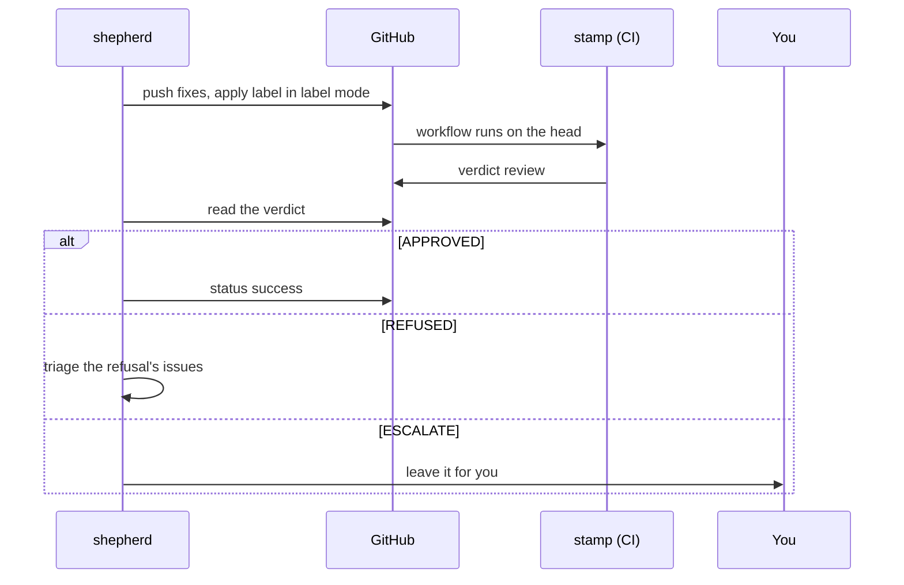

stamp's deterministic gates and approval sit at the end of the loop. In label mode shepherd applies the label once per head; in all-PRs mode stamp runs on each push by itself. Either way shepherd reads the verdict, acts on a refusal's issues through triage, and leaves an escalation to you. stamp keeps an approval across a base merge that leaves the diff unchanged, so ci-repair's branch updates cost no re-review.

Run locally, swarm's comments post through the author's account; in GitHub Actions they post as `github-actions[bot]`. A gate that treats another reviewer's comment as assurance must not count them; the comment header tells them apart. stamp treats both as automated.
