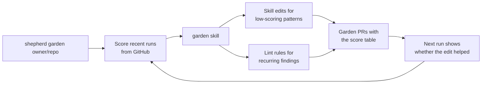

`shepherd garden <owner/repo>...` scores what shepherd did on recent PRs from GitHub, with optional trace measurements. It counts reverted fixes, people replying in a thread, and loops that hit the round cap, stopped short or went quiet. It also finds the lens rules triage fixed on 3+ PRs, from its `Shepherd-Fixes` trailers on PRs by people who can push.

The `garden` skill turns that into PRs: skill edits for the patterns behind low scores, and lint rules for recurring findings one file's syntax can decide, so swarm's checks catch them before any model reads the diff.

To run it weekly, copy [`.github/workflows/garden.yml`](https://github.com/jagreehal/shepherd/blob/main/.github/workflows/garden.yml) from the shepherd repository into the repository that holds your skills or policy pack; `shepherd workflows` does not install it. Set `GARDEN_REPOS`, a `GARDEN_TOKEN` that can open PRs on those repos, and a model key. The agent only proposes, and a separate job opens the PRs. Each garden PR carries the score table, so the next one shows whether a merged edit helped.

Pass `--traces <otlp.json>` for exported OTLP JSON/JSON-lines files, set `GARDEN_TEMPO_URL` and read-only `GARDEN_TEMPO_HEADERS` to query Grafana Tempo, or set `GARDEN_DATADOG_SITE`, `GARDEN_DATADOG_API_KEY` and an `apm_read` `GARDEN_DATADOG_APP_KEY` to query Datadog. Any mix of inputs can run together. Garden correlates known PR commits and deduplicates trace/span IDs, then flags observed stage failures, repeated retries, approval waits and review spend. Its report includes trace references, coverage limits and unpriced reviews. Trace measurements cannot count a fix as accepted or justify weakening a check. [Configure trace scoring](/shepherd/operations/gardener-telemetry/), including the bundled weekly workflow.
