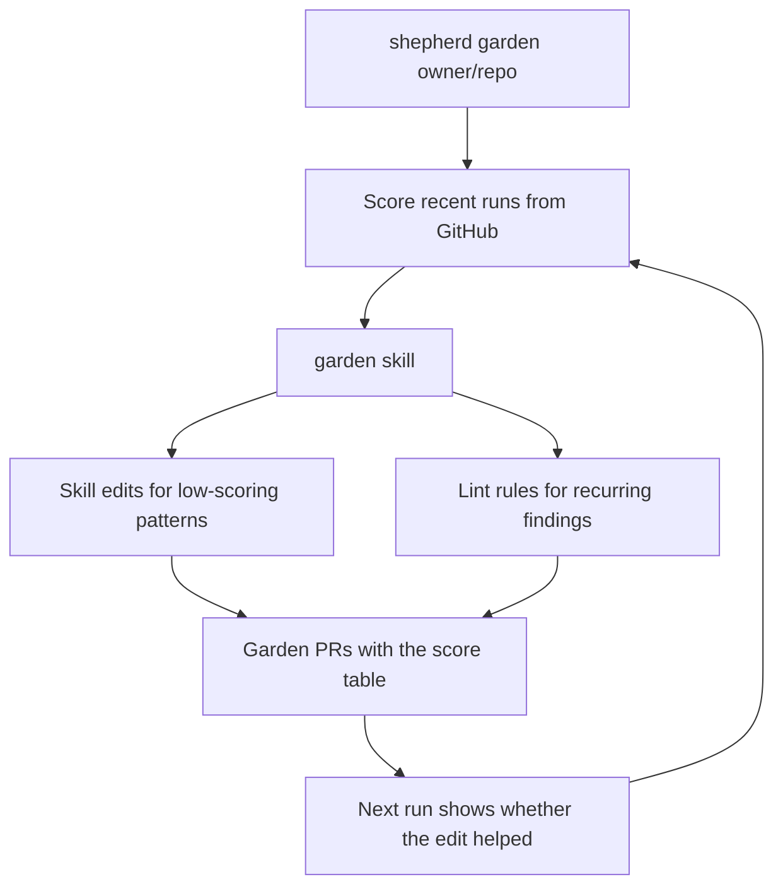

`shepherd garden` scores Shepherd's work on recent pull requests from GitHub, and the `garden` skill turns that score into pull requests that improve the skills. This page is for whoever maintains your skills or policy pack. The garden agent only proposes: its changes arrive as pull requests for you to review.



## Score recent runs

To score one or more repositories, run:

```bash
shepherd garden <owner/repo>...
```

Garden reads recent pull requests from GitHub, with optional [trace measurements](#add-trace-measurements). It reports on each of these:

- **Trouble signs**: reverted fixes, people replying in a thread, and loops that hit the round cap, stopped short or went quiet.
- **Recurring fixes**: the lens rules triage fixed on 3 or more pull requests. Garden counts them from triage's `Shepherd-Fixes` trailers, on pull requests by people who can push.
- **Rounds**: mean rounds, and the share of pull requests that finished in one.
- **Thread outcomes**: how each rule's threads ended: fixed, dismissed, argued or open.

## Turn scores into pull requests

The `garden` skill reads the score and opens pull requests of two kinds:

- **Skill edits**: changes to the skills for the patterns behind low scores.
- **Lint rules**: rules for recurring findings that one file's syntax can decide. Swarm's checks then catch them before any model reads the diff.

An incident that got past review also becomes a held-out eval case, so the set you [score the reviewer against](/shepherd/contributing/evaluation/) grows with each escape.

Each garden pull request carries the score table. The next one shows whether a merged edit helped.

## Run garden weekly

`shepherd workflows` doesn't install the garden workflow. To run it on a schedule, follow these steps.

**1. Copy the workflow**

Copy [`.github/workflows/garden.yml`](https://github.com/jagreehal/shepherd/blob/main/.github/workflows/garden.yml) from the Shepherd repository into the repository that holds your skills or policy pack.

**2. Set its inputs**

Set these in that repository:

- **`GARDEN_REPOS`**: the repositories to score.
- **`GARDEN_TOKEN`**: a token that can open pull requests on those repositories.
- **A model key**: the key for the model the agent runs on.

The agent only proposes. A separate job opens the pull requests.

## Add trace measurements

Garden can also read the spans Shepherd [exports](/shepherd/operations/traces/). Pick one or more of these inputs; any mix runs together:

| Input | What to set |
| --- | --- |
| Exported files | `--traces <otlp.json>` for each OTLP JSON or JSON-lines file |
| Grafana Tempo | `GARDEN_TEMPO_URL`, and read-only `GARDEN_TEMPO_HEADERS` |
| Datadog | `GARDEN_DATADOG_SITE`, `GARDEN_DATADOG_API_KEY`, and a `GARDEN_DATADOG_APP_KEY` scoped to `apm_read` |

Garden correlates the traces with known pull request commits and deduplicates trace and span IDs. It then flags observed stage failures, repeated retries, approval waits and review spend. Its report includes trace references, coverage limits and unpriced reviews.

Trace measurements can't count a fix as accepted, and they can't justify weakening a check.

To set up each input, including the bundled weekly workflow, see [Score exported traces in garden](/shepherd/operations/gardener-telemetry/).

## Related resources

- [Score exported traces in garden](/shepherd/operations/gardener-telemetry/): configure files, Tempo and Datadog, and read the trace signals
- [Trace an iteration](/shepherd/operations/traces/): the spans the review and the local loop export
- [Measure review accuracy](/shepherd/contributing/evaluation/): the eval cases garden adds to
- [Build and share review lenses](/shepherd/configuration/lenses/): the lens rules garden counts
