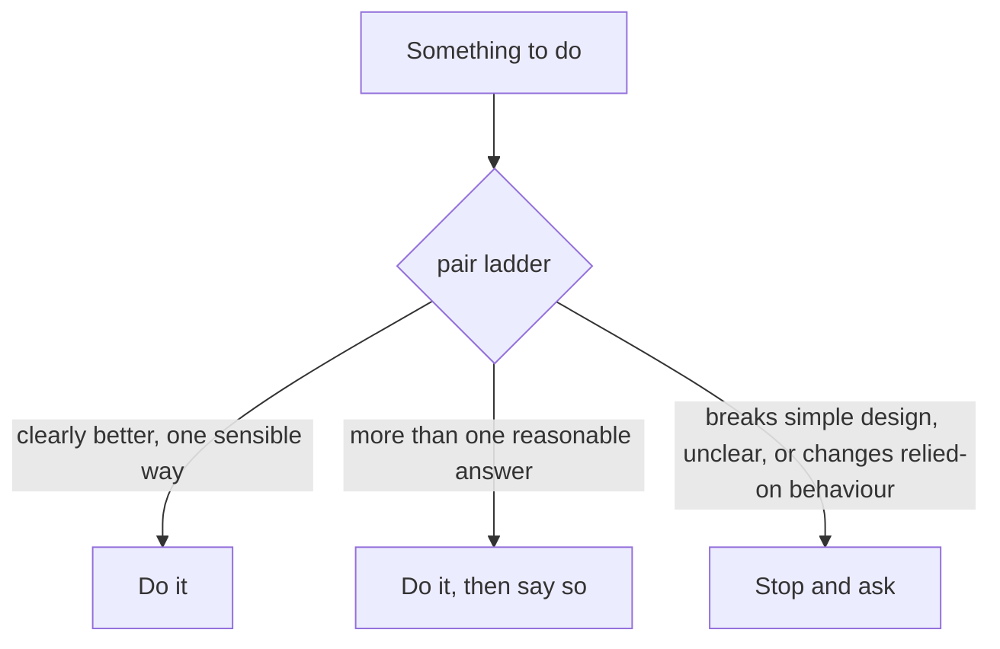

Shepherd installs as a pack of skills you run from your coding agent. The `shepherd` skill runs the loop and loads the others it needs. The [Command reference](/shepherd/reference/commands/) lists the skills you can run on their own.

## Skills in the pack

Find a skill in the first column to see what it does:

| Skill | What it does |
|---|---|
| `shepherd` | Runs the loop from your coding agent: review rounds until dry, then CI, then the CI review's verdict. Owns state, model choice, and when to ask you. |
| `swarm` | Runs the repo's own checks, then the router, correctness and every matching team lens in parallel, with a second wave for risky hunks the router hands on. Verifies serious findings, and posts inline comments plus one summary comment. |
| `triage` | Ends every review thread fixed, resolved, or deferred. Never replies, never touches a thread a human is in. |
| `ci-repair` | Works on the pull request's own head on a clean checkout. Diagnoses failing checks to the leaf job. Under `fixes.mode: push` it updates a stale branch, merges base conflicts it can settle, makes one verified fix and reruns flaky jobs once; under `local` and `suggest` it changes nothing on GitHub. A risky fix waits for a second model. |
| `incident` | After merge: turns a red default-branch run or a production error into an `incident` issue, a reproducing test, the pull request that caused it (by bisecting with that test), and a fix pull request the loop then takes over. On a public repository, a security failure stops before any issue or test. |
| `git-archaeology` | Traces how code reached its current state: when a line, function or file changed or left, and what it looked like before. |
| `pair` | The act / act-and-say / stop-and-ask ladder that decides when to ask you. |
| `review-correctness` | Bugs: data, concurrency, performance, API contracts, frontend state, tests. |
| `review-security` | Exploitable source-to-sink paths, each with its data flow and fix. |
| `review-simplicity` | The four rules of simple design; what to delete and what replaces it. |
| `review-maintainability` | Coupling, rollout safety, observability, naming, and the repo's own written rules. |
| `review-slop` | Low-signal code and prose: thrown-away types, defensive noise, tests that cannot fail, padded pull request text. |
| `review-spec` | The change against its issue or spec: requirements missing, built wrong, or not asked for. |
| `branch-review` | A two-axis review (Standards and Spec) of work since a commit, branch or tag. It is Matt Pocock's `code-review` with this repository's GitHub issues as its tracker, so it needs no setup. |
| `code-review`, `diagnosing-bugs`, `pr`, `retro`, `writing-for-agents` | [Matt Pocock's skills](https://github.com/mattpocock/skills), copied unchanged. `review-spec` runs code-review's Spec axis, `review-simplicity` adds its smell baseline, ci-repair diagnoses with diagnosing-bugs, shepherd writes pull request bodies with pr when the repo has no pull request skill, and garden sorts causes with retro and writes skill text by writing-for-agents. |
| `lens-import` | Converts any skill, rule set or style guide into a lens with one id per rule, severity tags, Fix guidance and the source's licence, then registers and validates it. |
| `garden` | The outer loop: scores shepherd's recent runs from GitHub and opens pull requests with skill edits and lint rules for findings that keep recurring. |

## When Shepherd asks you

The `pair` skill puts every action on a ladder. Shepherd acts, acts and tells you, or stops and asks:

## Related resources

- [Command reference](/shepherd/reference/commands/): the commands that run each skill
- [Review, triage and CI repair](/shepherd/concepts/review-loop/): how `shepherd`, `swarm`, `triage` and `ci-repair` work together
- [Build and share review lenses](/shepherd/configuration/lenses/): add your own lens, or import one with `lens-import`
- [Credits](/shepherd/reference/credits/): where the copied and adapted skills come from
