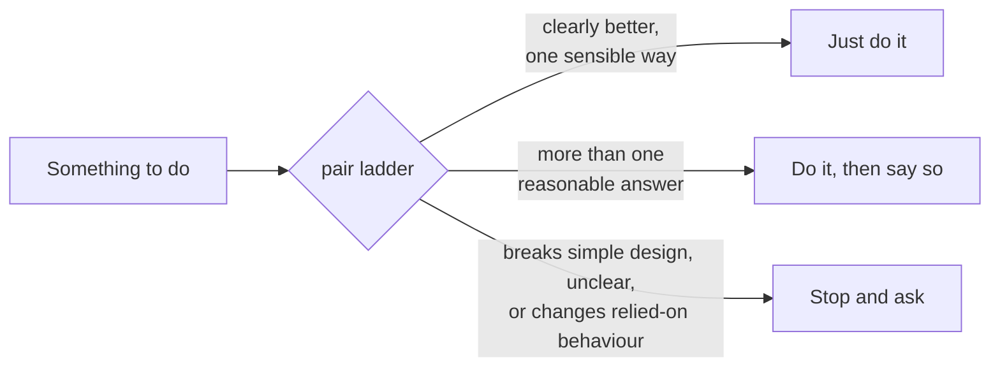

| Skill | Does |
|---|---|
| `shepherd` | Runs the loop: review rounds until dry, then CI, then the stamp verdict. Owns state, model choice, and when to ask you. |
| `swarm` | Runs the repo's own checks, then a cheap router review that hands risky hunks to the lenses in parallel, verifies serious findings, and posts inline comments plus one summary comment. |
| `triage` | Ends every review thread fixed, resolved, or deferred. Never replies, never touches a thread a human is in. |
| `ci-repair` | Updates a stale branch, diagnoses failing checks to the leaf job, makes one verified fix, reruns flaky jobs once. |
| `incident` | After merge: turns a red default-branch run or a production error into an `incident` issue, a reproducing test, the PR that caused it (by bisecting with that test), and a fix PR the loop then takes over. |
| `pair` | The act / act-and-say / stop-and-ask ladder that decides when to ask you. |
| `review-correctness` | Bugs: data, concurrency, performance, API contracts, frontend state, tests. |
| `review-security` | Exploitable source-to-sink paths, each with its data flow and fix. |
| `review-simplicity` | The four rules of simple design; what to delete and what replaces it. |
| `review-maintainability` | Coupling, rollout safety, observability, naming, and the repo's own written rules. |
| `review-slop` | Low-signal code and prose: thrown-away types, defensive noise, tests that cannot fail, padded PR text. |
| `review-spec` | The change against its issue or spec: requirements missing, built wrong, or not asked for. |
| `code-review`, `diagnosing-bugs`, `pr`, `retro`, `writing-for-agents` | [Matt Pocock's skills](https://github.com/mattpocock/skills), copied unchanged. `review-spec` runs code-review's Spec axis, `review-simplicity` adds its smell baseline, ci-repair diagnoses with diagnosing-bugs, shepherd writes PR bodies with pr when the repo has no PR skill, and garden sorts causes with retro and writes skill text by writing-for-agents. |
| `garden` | The outer loop: scores shepherd's recent runs from GitHub and opens PRs with skill edits and lint rules for findings that keep recurring. |

## When it asks you

